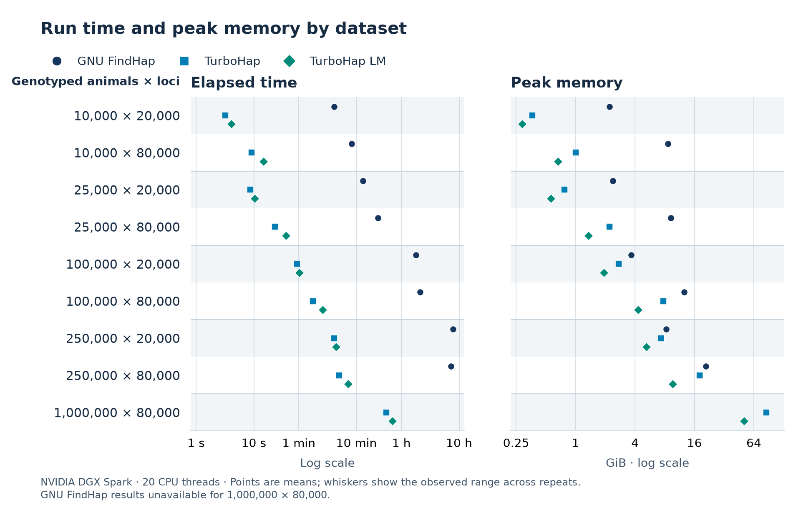

# TurboHap

<p align="center">
  
</p>

TurboHap phases haplotypes and imputes missing genotypes using the FindHap v3 method.
If you already use FindHap, you can keep your input files and analysis settings.
The benchmark outputs matched FindHap byte for byte, with one exception for
crossover record order.

Choose **TurboHap** for the quickest run, or **TurboHap LM** if RAM is limited.
LM uses temporary disk space to keep memory use down, so it usually takes a little longer.

<!-- OPENING_EXAMPLE_START -->
Here’s what that choice looked like on a simulated dairy cattle dataset with **250,000 genotyped animals and 80,000 loci**. We ran the same analysis using 20 CPU threads on an NVIDIA DGX Spark.

| Program | Run time | Peak memory |
| --- | --- | --- |
| GNU FindHap | 7 h 11 min | 20.9 GiB |
| TurboHap | 4 min 59 s (86.4× faster) | 18.1 GiB (13.5% reduction) |
| TurboHap LM | 7 min 12 s (59.9× faster) | 9.6 GiB (53.8% reduction) |
<!-- OPENING_EXAMPLE_END -->

You can try either mode with the [bundled FindHap example](examples/README.md)
before running your own data.

## New in v1.5.0

<!-- VERSION_COMPARISON_START -->
- Across [8 matched datasets](docs/turbohap_release_comparison_111126.md), v1.5.0 delivers a **1.22× speedup with 15% lower peak memory** in standard mode and a **1.27× speedup with 20% lower peak memory** in LM compared with v1.4.0. <!-- VERSION_COMPARISON_END -->
- Optional modern console output provides timestamped progress, phase timings
  and peak live-haplotype summaries. Legacy console output remains the default.
- Demand-zero library metadata and active bounds reduce unused-capacity memory
  on qualified native profiles while preserving the `maxhap` limit.
- LM supports adaptive 16/32-bit lookup storage for larger haplotype libraries.
- Population and pedigree matching improvements include native ARM64 NEON and
  qualified Intel/AMD vector paths, with compatible fallback paths.
- Integrated Mac improvements preserve metadata and prior-output ordering;
  the exact NEON final scan is shared across supported ARM64 builds.

See the [release notes](docs/turbohap_release_notes_111126.md) and
[changelog](CHANGELOG.md) for the complete changes from v1.4.0.

## Performance

<!-- HEADLINE_START -->
On the 100,000-animal, 20,000-locus dataset, TurboHap ran **116.4× faster** than GNU FindHap.
<!-- HEADLINE_END -->

The new benchmarks use structured cattle pedigrees, public SNP-chip maps,
uneven chromosome lengths and marker density, mixed-density genotyping,
missing calls and simulated calling errors. These are more realistic and
challenging workloads than the older release benchmarks. They are different
datasets, so the tables are **not a direct version-to-version comparison**.

All measurements use **20 CPU threads on an NVIDIA DGX Spark**,
**GCC/gfortran 13.3**, matching inputs and options, and internal NVMe working
storage. The GPU is not used. Values are arithmetic means of two technical
repetitions for each TurboHap mode. GNU FindHap has two repetitions for each
10k, 25k and 100k dataset, and one per 250k dataset. All eight planned
control datasets are complete; no 1M × 80k control is planned because of time
and resource limits. Missing values are not estimated.



<!-- BENCHMARK_TABLES_START -->
### Runtime

| Genotyped animals × loci | GNU FindHap | TurboHap | Speedup | TurboHap LM | Speedup |
| --- | --- | --- | --- | --- | --- |
| 10,000 × 20,000 | 4m 04s | 3.17 s | 77.1× | 4.07 s | 60.0× |
| 10,000 × 80,000 | 8m 19s | 9.08 s | 55.0× | 14.71 s | 33.9× |
| 25,000 × 20,000 | 12m 58s | 8.64 s | 90.1× | 10.35 s | 75.2× |
| 25,000 × 80,000 | 23m 26s | 23.16 s | 60.7× | 36.28 s | 38.8× |
| 100,000 × 20,000 | 1h 47m 57s | 55.63 s | 116.4× | 1m 02s | 105.0× |
| 100,000 × 80,000 | 2h 6m 40s | 1m 45s | 72.3× | 2m 38s | 48.1× |
| 250,000 × 20,000 | 7h 47m 53s | 4m 06s | 114.2× | 4m 25s | 105.8× |
| 250,000 × 80,000 | 7h 11m 03s | 4m 59s | 86.4× | 7m 12s | 59.9× |
| 1,000,000 × 80,000 | Not run | 32m 47s | — | 42m 26s | — |

### Peak memory

Memory in GiB; reductions are relative to GNU FindHap.

| Genotyped animals × loci | GNU FindHap | TurboHap | Reduction | TurboHap LM | Reduction |
| --- | --- | --- | --- | --- | --- |
| 10,000 × 20,000 | 2.213 | 0.364 | 83.5% | 0.289 | 86.9% |
| 10,000 × 80,000 | 8.577 | 1.006 | 88.3% | 0.670 | 92.2% |
| 25,000 × 20,000 | 2.385 | 0.774 | 67.5% | 0.568 | 76.2% |
| 25,000 × 80,000 | 9.243 | 2.206 | 76.1% | 1.360 | 85.3% |
| 100,000 × 20,000 | 3.669 | 2.740 | 25.3% | 1.944 | 47.0% |
| 100,000 × 80,000 | 12.591 | 7.720 | 38.7% | 4.326 | 65.6% |
| 250,000 × 20,000 | 8.325 | 7.288 | 12.5% | 5.249 | 37.0% |
| 250,000 × 80,000 | 20.893 | 18.081 | 13.5% | 9.646 | 53.8% |
| 1,000,000 × 80,000 | Not run | 85.328 | — | 51.259 | — |
<!-- BENCHMARK_TABLES_END -->

Both TurboHap modes matched their reference output files on all nine datasets.
In the eight comparisons with GNU FindHap, nine files matched byte for byte.
The tenth, `cross.overs`, contained the same records in a different order.
See [output compatibility](docs/COMPATIBILITY.md) for how the files were compared.

See the [full benchmark method, figures and individual observations](docs/turbohap_benchmarks_111126.md)
and [synthetic-dataset recipe](docs/SYNTHETIC_DATASETS.md).
The exact inputs for all nine benchmarks are available on Zenodo.

[](https://doi.org/10.5281/zenodo.24144449)

Runtime includes reading, computation, buffered writing and LM scratch activity;
memory is peak process RSS. Performance depends on the data, settings, storage,
hardware and competing load. Timed runs used the optional modern console mode.

TurboHap works on **Apple Silicon Macs, Linux ARM64 and Intel/AMD x86-64**.
Detailed benchmarking on these systems is ongoing.

## Install and run

Build TurboHap v1.5.0 from source. Clone the release tag:

```sh
git clone --branch v1.5.0 --depth 1 https://github.com/adrian-greenneuron/TurboHap.git
cd TurboHap
```

On Ubuntu/Debian Linux, install a C++17 compiler, OpenMP and CMake:

```sh
sudo apt update
sudo apt install build-essential cmake python3
cmake -S . -B build -DCMAKE_BUILD_TYPE=Release -DCMAKE_CXX_COMPILER=g++
cmake --build build --parallel 2
./build/findhap --help
```

On Apple Silicon macOS, install the Command Line Tools and Homebrew prerequisites:

```sh
xcode-select --install
brew install cmake libomp gcc python
```

Then follow the [Mac build instructions](MACOS.md), which explain compiler
selection and OpenMP. The optional M4-specific build is separate from the
general Apple Silicon installation. Other Linux distributions can use their
equivalent C++/OpenMP and CMake packages. Windows users can use WSL2; native
Windows builds are not supported.

Build on the machine where you will run TurboHap. No GPU, CUDA or Fortran
compiler is required. The executable is called `findhap`. Run it from a
writable directory containing your input files:

```sh
/path/to/TurboHap/build/findhap 20
```

The number is the requested CPU thread count. See the [thread settings](docs/USAGE.md)
for platform defaults. Add `--low-memory` to choose TurboHap LM. If you run
both modes and want to keep both sets of results, use separate run directories.

Inputs are `findhap.options`, `pedigree.file`, `chromosome.data` and
`genotypes.txt`, plus any active prior files. Run the independent input auditor
before inference if you want a detailed report:

```sh
/path/to/TurboHap/build/turbohap-validate-inputs --directory /path/to/inputs
```

To save the optional improved console output and diagnostics separately:

```sh
/path/to/TurboHap/build/findhap 20 --stdout=modern > run.log 2> diagnostics.log
```

Legacy STDOUT is the default. The console selection does not change result-file
formats. See [console output and run logs](docs/USAGE.md#console-output-and-run-logs).

- [Installation and platform instructions](docs/INSTALL.md)
- [Inputs, outputs, CPU policies and options](docs/USAGE.md)
- [Standalone input validator](docs/INPUT_VALIDATION.md)
- [Output compatibility](docs/COMPATIBILITY.md)
- [Small installation example](examples/README.md)
- [Release qualification](docs/RELEASE_CHECKS.md)

## Manuscript

The [author manuscript (PDF)](docs/paper/turbohap_manuscript_221026.pdf) and
[supplementary material](docs/paper/README.md), dated 22 October 2026, describe
v1.0.0 and its historical datasets. They have not been revised for v1.5.0 and
have not been peer reviewed. Their historical data are available on
[Zenodo](https://doi.org/10.5281/zenodo.23566926); these are **not** the new
datasets used in the tables above.

## Licence and commercial use

**Free for non-commercial academic research and teaching. Commercial use
requires a paid licence.** This includes paid imputation, genetic evaluation
and consultancy delivered by universities, charities or government
institutions, even when charges only recover costs. Ordinary research grants
do not by themselves make academic research commercial.

TurboHap is licensed by **Green Neuron Ltd, trading as Green Neuron AI**.
Using TurboHap gives us no ownership of your data or results. Publications
must acknowledge TurboHap and the original FindHap method. See the
[licence](LICENSE), [citation](CITATION.cff) and
[credits](docs/ACKNOWLEDGEMENTS.md), or contact
[Adrian Carr](mailto:adrian.carr@greenneuron.ai) for commercial licensing.

The original FindHap algorithm and Fortran program were developed by
Paul M. VanRaden at USDA. Original attribution and licence notices are retained.
