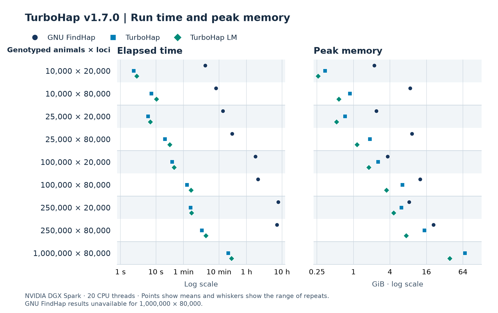

# TurboHap

<p align="center">
  
</p>

TurboHap phases haplotypes and imputes missing genotypes using the FindHap v3 method.
If you already use FindHap, you can keep your input files and analysis settings.
The default analysis follows FindHap v3. On the eight benchmark datasets with
a FindHap control, both programs produced the same result records. Crossover
records can appear in a different order.

Choose **TurboHap** for the quickest run, or **TurboHap LM** if RAM is limited.
LM uses temporary disk space to keep memory use down, so it usually takes a little longer.

<!-- OPENING_EXAMPLE_START -->
Here’s what that choice looked like on a simulated dairy cattle dataset with **250,000 genotyped animals and 80,000 loci**. We ran the same analysis using 20 CPU threads on an NVIDIA DGX Spark.

| Program | Run time | Peak memory |
| --- | --- | --- |
| GNU FindHap | 7 h 11 min | 20.9 GiB |
| TurboHap | 3 min 19 s (129.9× faster) | 14.9 GiB (28.7% reduction) |
| TurboHap LM | 4 min 20 s (99.6× faster) | 7.5 GiB (64.2% reduction) |
<!-- OPENING_EXAMPLE_END -->

You can try either mode with the [bundled FindHap example](examples/README.md)
before running your own data.

## What changed in v1.7.0 and v1.6.0

### v1.7.0 · Faster haplotype matching

Both modes now screen up to 512 candidate haplotypes at a time. They examine the surviving candidates in the same order and apply the same matching rules. Existing commands and input files work as before. Native builds choose the scanner automatically, including on Intel and AMD servers and Apple silicon Macs.

Across the nine Spark benchmarks, v1.7.0 used **13.1% less time in Standard** and **11.5% less in LM** than v1.6.0, giving each dataset equal weight. The largest change in mean peak memory was 0.13%. [Comparison with v1.6.0](docs/turbohap_release_comparison_221126.md) · [Full v1.7.0 release notes](docs/turbohap_release_notes_221126.md)

### v1.6.0 · New scientific options and lower memory use

- With X on the map, `--x-progeny=corrected` lets both parents contribute when reconstructing a male’s autosomal haplotypes from his offspring. [Illustrated X-progeny guide](docs/X_PROGENY.md)
- With `--processing-scope=chromosome`, each chromosome has its own reference eligibility, quality scores and result files. It automatically uses corrected X-progeny scoring. The default in both releases is the FindHap v3 genome-wide analysis. [Worked coverage examples](docs/PROCESSING_SCOPE.md)
- v1.6.0 added earlier input and capacity checks, a one-command Mac installer and automatic native processor selection. Across nine datasets, v1.6.0 was 1.36× as fast as v1.5.0 in Standard and 1.48× as fast in LM, with 13% and 15% lower peak memory, respectively. [Full v1.6.0 release notes](https://github.com/adrian-greenneuron/TurboHap/blob/v1.6.0/docs/turbohap_release_notes_201126.md)

[Release history from v1.0.0 to v1.7.0](docs/turbohap_release_history_221126.md)

## Performance

<!-- HEADLINE_START -->
On the 250,000-animal, 20,000-locus dataset, TurboHap ran **295.8× faster** than GNU FindHap.
<!-- HEADLINE_END -->

These are the same nine simulated dairy-cattle datasets used for v1.5.0 and v1.6.0. They include uneven marker spacing, overlapping SNP panels, incomplete pedigrees, missing calls and genotyping errors.

Both TurboHap modes ran twice per dataset on an NVIDIA DGX Spark using 20 CPU threads, GCC 13.3 and internal NVMe storage. The tables give arithmetic means. We used the published GNU FindHap controls from v1.5.0, run with GNU Fortran 13.3 and the same inputs, settings and thread count. They have two repetitions per dataset through 100,000 animals and one for each 250,000-animal dataset. The million-animal comparison covers Standard and LM only.



<!-- BENCHMARK_TABLES_START -->
### Runtime

| Genotyped animals × loci | GNU FindHap | TurboHap | Speedup | TurboHap LM | Speedup |
| --- | --- | --- | --- | --- | --- |
| 10,000 × 20,000 | 4m 04s | 2.38 s | 102.9× | 2.90 s | 84.2× |
| 10,000 × 80,000 | 8m 19s | 7.47 s | 66.8× | 10.48 s | 47.6× |
| 25,000 × 20,000 | 12m 58s | 5.96 s | 130.5× | 7.00 s | 111.3× |
| 25,000 × 80,000 | 23m 26s | 17.89 s | 78.6× | 24.89 s | 56.5× |
| 100,000 × 20,000 | 1h 47m 57s | 28.61 s | 226.4× | 32.92 s | 196.8× |
| 100,000 × 80,000 | 2h 6m 40s | 1m 15s | 100.8× | 1m 38s | 77.3× |
| 250,000 × 20,000 | 7h 47m 53s | 1m 35s | 295.8× | 1m 41s | 277.7× |
| 250,000 × 80,000 | 7h 11m 03s | 3m 19s | 129.9× | 4m 20s | 99.6× |
| 1,000,000 × 80,000 | Not run | 18m 13s | — | 22m 57s | — |

### Peak memory

Peak process RSS is given in GiB. Reductions are relative to GNU FindHap.

| Genotyped animals × loci | GNU FindHap | TurboHap | Reduction | TurboHap LM | Reduction |
| --- | --- | --- | --- | --- | --- |
| 10,000 × 20,000 | 2.213 | 0.340 | 84.6% | 0.262 | 88.2% |
| 10,000 × 80,000 | 8.577 | 0.875 | 89.8% | 0.577 | 93.3% |
| 25,000 × 20,000 | 2.385 | 0.724 | 69.6% | 0.530 | 77.8% |
| 25,000 × 80,000 | 9.243 | 1.877 | 79.7% | 1.153 | 87.5% |
| 100,000 × 20,000 | 3.669 | 2.547 | 30.6% | 1.792 | 51.2% |
| 100,000 × 80,000 | 12.591 | 6.443 | 48.8% | 3.509 | 72.1% |
| 250,000 × 20,000 | 8.325 | 6.205 | 25.5% | 4.631 | 44.4% |
| 250,000 × 80,000 | 20.893 | 14.887 | 28.7% | 7.482 | 64.2% |
| 1,000,000 × 80,000 | Not run | 69.386 | — | 38.889 | — |
<!-- BENCHMARK_TABLES_END -->

Both TurboHap modes matched their reference output files on all nine datasets.
In the eight comparisons with GNU FindHap, nine files matched byte for byte.
The tenth, `cross.overs`, contained the same records in a different order.
See [output compatibility](docs/COMPATIBILITY.md) for how the files were compared.

See the [full benchmark method, figures and individual observations](docs/turbohap_benchmarks_221126.md)
and [synthetic-dataset recipe](docs/SYNTHETIC_DATASETS.md).
The exact inputs for all nine benchmarks are available on Zenodo.

[](https://doi.org/10.5281/zenodo.24144449)

Runtime includes reading, computation, buffered writing and LM scratch activity;
memory is peak process RSS. Performance depends on the data, settings, storage,
hardware and competing load. Timed runs used the optional modern console mode.

## Install and run

Download the source ZIP from the v1.7.0 release’s **Assets**. Extract it and open the folder containing `CMakeLists.txt`. The source package includes the small example used to check your installation.

**Linux, including Intel, AMD and Arm servers.** On Debian or Ubuntu, install the build tools, then build on the computer that will run TurboHap.

```sh
sudo apt update
sudo apt install build-essential cmake python3
cmake -S . -B build -DCMAKE_BUILD_TYPE=Release
cmake --build build --parallel 2
./build/findhap --help
python3 examples/check_installation.py
```

**Apple Silicon Mac.** Install Apple’s Command Line Tools and native Homebrew if needed. From the extracted folder, run:

```sh
sh tools/install-macos.sh
```

The installer builds the software, checks both modes on the example and places the programs in `~/Applications/TurboHap/bin/`. See the [Mac guide](MACOS.md) for the prerequisites and [installation guide](docs/INSTALL.md) for portable builds, Windows through WSL2 and details for other Linux distributions.

**Run an analysis.** From a writable directory containing the inputs, supply the path to the installed or built program and your thread count. For example:

```sh
/path/to/findhap 20
```

Add `--low-memory` for LM. Use separate working directories when keeping results from both modes. The [usage guide](docs/USAGE.md) explains thread selection and the two optional scientific settings.

Inputs are `findhap.options`, `pedigree.file`, `chromosome.data` and
`genotypes.txt`, plus any active prior files. Run the independent input auditor
before inference if you want a detailed report:

```sh
/path/to/TurboHap/build/turbohap-validate-inputs --directory /path/to/inputs
```

To save the optional improved console output and diagnostics separately:

```sh
/path/to/TurboHap/build/findhap 20 --stdout=modern > run.log 2> diagnostics.log
```

Legacy STDOUT is the default. The console selection does not change result-file
formats. See [console output and run logs](docs/USAGE.md#console-output-and-run-logs).

- [Installation and platform instructions](docs/INSTALL.md)
- [Inputs, outputs, CPU policies and options](docs/USAGE.md)
- [Standalone input validator](docs/INPUT_VALIDATION.md)
- [Output compatibility and verification results](docs/COMPATIBILITY.md)
- [Small installation example](examples/README.md)

## Manuscript

The manuscript and supplement use **TurboHap v1.6.0** for all code and benchmark results. The paper describes the FindHap algorithm, the implementation and the nine-dataset study. [Manuscript (PDF)](docs/paper/v1.6.0/turbohap_manuscript_201126.pdf) · [Supplementary methods (PDF)](docs/paper/v1.6.0/turbohap_supplement_201126.pdf) · [v1.7.0 benchmarks](docs/turbohap_benchmarks_221126.md) · [Original October study](https://github.com/adrian-greenneuron/TurboHap/tree/v1.5.0/docs/paper)

## Licence and commercial use

**Free for non-commercial academic research and teaching. Commercial use
requires a paid licence.** This includes paid imputation, genetic evaluation
and consultancy delivered by universities, charities or government
institutions, even when charges only recover costs. Ordinary research grants
do not by themselves make academic research commercial.

The source code is available under the **TurboHap Academic Research Licence**,
issued by Green Neuron Ltd, trading as Green Neuron AI.
Using TurboHap gives us no ownership of your data or results. Publications
must acknowledge TurboHap and the original FindHap method. See the
[licence](LICENSE), [citation](CITATION.cff) and
[credits](docs/ACKNOWLEDGEMENTS.md), or contact
[Adrian Carr](mailto:adrian.carr@greenneuron.ai) for commercial licensing.

The original FindHap algorithm and Fortran program were developed by
Paul M. VanRaden at USDA. Original attribution and licence notices are retained.
