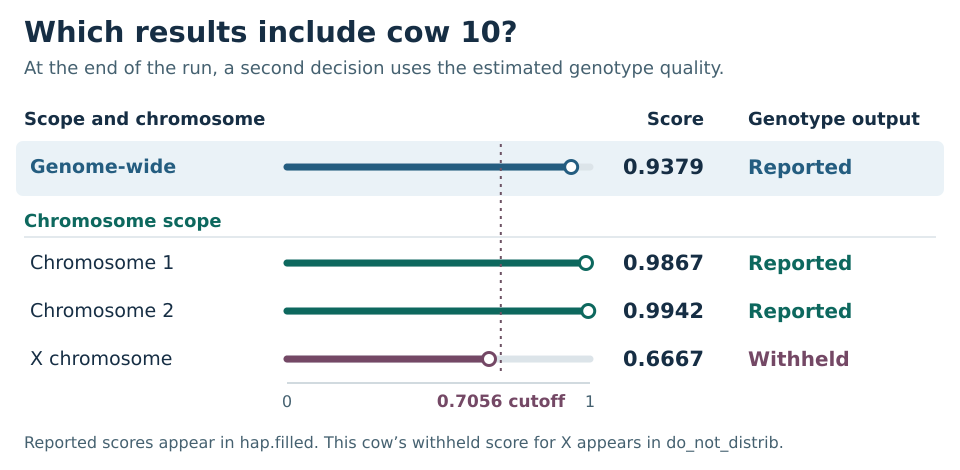

# When should an animal’s genotype be assessed chromosome by chromosome?

A cow has chip calls on chromosomes 1 and 2, but none on X. Should she appear in the imputed results for X? FindHap v3 and TurboHap’s default analysis give her one quality score for the whole genome. TurboHap v1.6.0 offers a second choice. With `--processing-scope=chromosome`, she can qualify on chromosome 1 and fall below the reporting cutoff on X.

## Which animals help establish the haplotypes?

Both approaches match haplotypes within segments of a single chromosome. The difference starts with how an animal qualifies for the first round of population matching. In a run without a prior haplotype library, animals with calls at **at least 40% of the mapped markers** enter the high-density group for that round. Coverage here means the fraction of marker positions with a genotype call. A marker absent from the animal’s SNP chip also counts as missing.

- **Genome-wide scope** (`legacy`, the default) adds up the calls across the whole map and divides by the total number of markers. FindHap v3 uses that classification across all chromosomes. [Original FindHap v3 program and documentation](https://www.ars.usda.gov/northeast-area/beltsville-md-barc/beltsville-agricultural-research-center/agil/aip/software/findhap/)
- **Chromosome scope** repeats the calculation within each chromosome. An animal with good coverage on chromosome 1 can help establish haplotypes there even if its other chromosomes are sparsely typed. Conversely, good coverage elsewhere cannot qualify it for the first high-density pass on X.

### Two cows with opposite first-pass decisions

These cows come from the same simulated family. Their map has 48 markers on chromosome 1, 48 on chromosome 2 and 24 on X. We masked some genotype calls to give the cows different coverage on each chromosome.


- **X enters the first pass on the strength of calls elsewhere.** Cow 10 has **93/120** markers called genome-wide (**77.5%**), so the default first pass includes her on X. All 93 calls lie on chromosomes 1 and 2. With **0/24** calls on X, chromosome scope skips her there for that pass.
- **Chromosome 1 has enough calls locally but is skipped in the genome-wide first pass.** Cow 88 has calls at **24/48 markers on chromosome 1 (50%)**, **14/48 on chromosome 2 (29.2%)** and **7/24 on X (29.2%)**. Across the whole map that gives her **45/120 (37.5%)**, three calls short of the 40% threshold. Genome-wide matching waits until round 2 to use her on any chromosome. With chromosome scope, she enters round 1 on chromosome 1 and round 2 on chromosome 2 and X.

These are decisions about **when** an animal enters population matching. An animal skipped in the first pass can still receive inferred calls through later matching or its relatives. At subsequent segment-length stages, calls filled earlier can count towards coverage.

## Which animals appear in the results?

After imputation, the program makes a separate decision about which animals to report. It estimates genotype quality and requires a score **above 0.7056** (0.84²). With observed markers, the estimate uses the animal’s called markers, the length of the region analysed and the number of high-density reference animals. With no observed markers, it uses the number of informative offspring and the proportion of marker genotypes it could infer. This also allows ungenotyped ancestors to qualify when the pedigree and output settings support it.



TurboHap filled all 24 markers on X for cow 10, yet her quality score for X was only **0.6667**. She appears in the default genome-wide `genotypes.filled` and in the separate genotype files for chromosomes 1 and 2. Her quality record for X appears in `do_not_distrib`. The score estimates the squared correlation with true genotypes. Measuring accuracy directly requires known genotypes for comparison.

## When would I choose chromosome scope?

- **You are analysing a particular chromosome across mixed SNP chips.** A genome-wide score can mask a poorly covered chromosome or exclude an animal with useful local data. Chromosome scope makes the local evidence visible. Check the marker count as well as the percentage. On a sparsely mapped chromosome, a few calls can move an animal across the 40% threshold.
- **You want the answer you would get by running that chromosome on its own.** Supply the complete map and pedigree once. TurboHap applies the matching and reporting decisions separately for each chromosome. Both the calls and the animals reported can differ from extracting the same markers from a genome-wide result. When joining chromosome files, match animals by ID because the rows can differ.
- **You need continuity with an earlier FindHap analysis or one genome-wide set of animals.** Use the default. Each animal then has one reporting decision for its complete genotype record.

## Running the analysis

In a fresh working directory containing the usual inputs, choose either Standard or low-memory mode.

```sh
findhap 20 --processing-scope=chromosome
```

```sh
findhap 20 --low-memory --processing-scope=chromosome
```

The enabled output files appear under `chromosome-results/chrN/`, where `N` is the chromosome number from the map. Marker and segment indices start at one within each result set. Chromosome scope automatically uses corrected X-progeny scoring and reports that choice at startup, including when it overrides an explicit `--x-progeny=legacy`. To change only the X scoring rule while keeping genome-wide coverage and filtering, use `--x-progeny=corrected` on its own. If you use prior haplotype libraries, run each chromosome separately with its own priors. [X-progeny scoring](X_PROGENY.md) · [Output directories and prior libraries](USAGE.md#processing-each-chromosome-independently)

**How we checked the examples.** We ran the 192-animal family in Standard and LM. To check first-pass membership, we left out one cow’s genotype record at a time and checked whether the high-density count fell by one in the whole-genome and single-chromosome runs. For each mode, all ten files for each chromosome matched a standalone run on the same markers and pedigree with corrected X scoring and the usual filters. That gave **60 of 60 file matches**, including genotype calls, quality scores and which animals were reported. Cow 10’s genome-wide score and reporting decision also agreed with corrected X scoring switched on, so the contrast shown here is attributable to scope. [Qualification on a cohort with X](COMPATIBILITY.md#what-the-release-benchmarks-checked)
