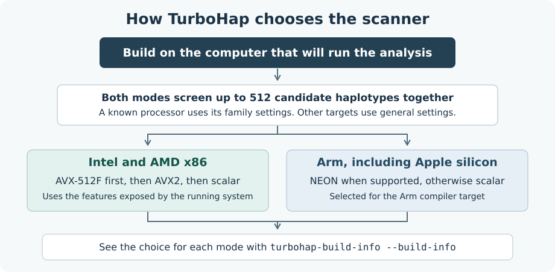

# Which processors is TurboHap optimised for?

Build TurboHap on the computer that will run your analyses. For the processor families below, a native build automatically selects the family optimisations your compiler supports. The same installation gives you both Standard and low-memory (LM) mode. [Linux installation](INSTALL.md#linux) · [Mac installation](../MACOS.md#install)

| Platform | Processor family | Optimised generations | Haplotype scanner in v1.7.0 |
| --- | --- | --- | --- |
| Linux, x86-64 | Intel Xeon | Cascade Lake (2nd generation), Ice Lake (3rd), Sapphire Rapids (4th), Emerald Rapids (5th) and Granite Rapids (Xeon 6 P-cores) | AVX-512F when exposed by the system |
| Linux, x86-64 | AMD EPYC | Milan (Zen 3) | AVX2 |
| Linux, x86-64 | AMD EPYC | Genoa (Zen 4) and Turin (Zen 5) | AVX-512F when exposed by the system |
| Linux, Arm64 | Google Axion | Arm Neoverse V2 and Neoverse N3 | NEON |
| Linux, Arm64 | NVIDIA GB10 | GB10 in the DGX Spark | NEON |
| macOS, Apple silicon | Apple M-series | M1 through M6, including base, Pro, Max and Ultra models where available | NEON |

Google Cloud’s C4A machines use the Neoverse V2-based Axion processor. N4A machines use the Neoverse N3-based Axion processor. Standard and LM both screen up to 512 candidate haplotypes per batch. This number describes how many candidates are considered together. The processor can handle the batch with one or more vector instructions.

The [v1.7.0 benchmark timings and peak memory measurements](turbohap_benchmarks_221126.md) cover the DGX Spark. Performance on your system depends on the dataset, thread count, available memory and SSD speed. SSD speed can be particularly important in LM, which uses temporary files during analysis.

## What if my processor is unfamiliar?

On a supported operating system and architecture, you can use the usual installation instructions even if your processor is missing from the table. If no family profile matches, TurboHap uses the general settings for its compiler target. On x86, the scanner checks which vector instructions the operating system makes available. It uses AVX-512F first, then AVX2, then the scalar implementation. Arm builds use NEON when available and otherwise use the scalar implementation. You can [check the installation with the small example](../examples/README.md) before committing to a large analysis. If you distribute one executable to several different processors, use the [portable build instructions](INSTALL.md#processor-support).



## How can I see which settings my build uses?

On Linux, run this command from the source directory after building.

```sh
./build/turbohap-build-info --build-info
```

On a Mac, the supplied installer puts the same tool in your Applications folder.

```sh
~/Applications/TurboHap/bin/turbohap-build-info --build-info
```

| What you want to check | Fields in the build report |
| --- | --- |
| Which processor the build identified | `configure_cpu_model` and `profile_selection` |
| Which compiler and options it used | `compiler` and `compile_flags` |
| Which optimisations each mode uses | `engines.standard` and `engines.lm` |
| How many candidates each mode checks together | `ordered_scan_candidates` in each engine entry |
| Which instructions and layout it uses | `ordered_scan_backend` and `ordered_scan_layout` in each engine entry |

If the processor model reads `unknown`, check `profile_selection` and the two engine entries to see what the build actually selected. Add `> turbohap-build.json` to either command to save the report. For the thread count TurboHap would use on the machine running the analysis, use `findhap --cpu-info` from the same installation.

## When should I email the author?

Email [Adrian Carr](mailto:adrian.carr@greenneuron.ai) if installation or the example check fails, if a native build uses general settings on a processor listed above, or if an analysis takes markedly longer or uses more memory than you expected.

Include your processor model, operating system and the build report if available. For an installation problem, include the command and error message. For a performance question, include Standard or LM, thread count, numbers of animals and loci, elapsed time and peak memory if known. Those details are enough to start without sharing any animal records.
