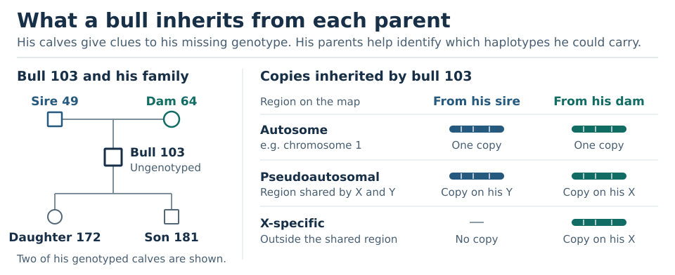

# Why X markers can change a bull’s inferred haplotypes on chromosome 1

A bull inherits one copy of chromosome 1 from his sire and one from his dam. Yet when a marker map includes the X chromosome, FindHap v3 can give his dam’s haplotypes extra weight and overlook his sire’s haplotypes on chromosome 1. This happens in one step that reconstructs bulls that were never genotyped. TurboHap v1.6.0 offers `--x-progeny=corrected` for this step. The default genome-wide analysis retains the FindHap v3 rule.

## Reconstructing a bull from his calves

Imagine a bull whose DNA was never collected, but whose calves have been genotyped. The calves provide clues to the **haplotypes** he passed on – stretches of DNA inherited together. To decide between possible haplotypes, FindHap counts the evidence from the calves and gives extra weight to a haplotype that also matches one carried by the bull’s **own** parents.

On an autosome such as chromosome 1, either parent can support a candidate haplotype. The same applies to the **pseudoautosomal region** (PAR), a stretch shared by X and Y. A bull has one copy there on the Y he received from his sire and one on the X he received from his dam. On the **X-specific region**, only his dam could have supplied the sequence. He can pass that X-specific DNA to his daughters. His sons receive his Y. [X inheritance in cattle, Zhang et al. (2020)](https://pmc.ncbi.nlm.nih.gov/articles/PMC7553937/)

## Where the two scoring rules differ

FindHap v3 places the X-specific markers last on the map. In the step that reconstructs an ungenotyped parent from offspring, it chooses which parents to consult **before** working through that bull’s chromosome segments. It uses the segment position left over from the preceding pass. If that position has reached X, scoring starts again at chromosome 1 with the dam in both parental comparisons. The program keeps that choice for **every** segment, so a match on the dam’s side can count twice on any autosome. The program still seeks two autosomal haplotypes for the bull. The change is in the weight each candidate receives. [USDA FindHap v3 source and map conventions](https://www.ars.usda.gov/northeast-area/beltsville-md-barc/beltsville-agricultural-research-center/agil/aip/software/findhap/)

For example, suppose a calf suggests a chromosome 1 haplotype that matches one copy in the bull’s sire and neither copy in his dam. The calf contributes one point under either rule. With the legacy X rule in effect, the sire’s match adds nothing. Corrected scoring gives the candidate a second point for that match. This can change which haplotypes the bull is assigned and, in later rounds, the calls inferred for his relatives. When the same candidates win, the results can be identical.

We regard the carryover as a likely unintended bug in FindHap v3. Adding X markers cannot change who could have supplied the bull’s chromosome 1. **Corrected scoring chooses the parents afresh for each segment, according to its place on the map.** The map setting `XChrom` identifies the X-specific group. For example, if group 30 is the PAR and `XChrom=31`, group 30 uses both parents and group 31 uses the maternal rule. With `XChrom=0`, corrected scoring treats every group as diploid in this step.

## What changed in the example family?

In the simulated pedigree shown above, both calves had a few missing chip calls. At the second marker on chromosome 1, legacy scoring imputed a heterozygous genotype (AB) for daughter 172. Corrected scoring reported one A allele and left the other unresolved. Across all 138 animals in `genotypes.filled`, exactly three calls differed, all at originally missing markers on chromosome 1 in calves 172 and 181. Their sire, bull 103, had no genotype record.

We checked this 192-animal example in Standard and LM. Each mode matched all ten files from the original Fortran under legacy scoring. Under corrected scoring they each matched all ten files from a separately modified Fortran program that applies the maternal rule segment by segment. These checks establish how the option behaves. Estimating its effect on imputation accuracy would require comparison with known genotypes across representative families.

## Which option should I use?

| Aim | Genome-wide or chromosome setting |
| --- | --- |
| Reproduce a FindHap v3 or TurboHap v1.5.0 analysis | Use the default genome-wide run. The explicit equivalent is `--x-progeny=legacy`. |
| Keep a genome-wide analysis and use chromosome-appropriate parental evidence | Add `--x-progeny=corrected` to the usual Standard or LM command. |
| Analyse and report each chromosome separately | Use `--processing-scope=chromosome`. It automatically selects corrected scoring, overrides an explicit `--x-progeny=legacy` and also applies coverage and quality filters per chromosome. |

[How chromosome scope changes matching and reporting](PROCESSING_SCOPE.md) · [Commands and examples](USAGE.md#correcting-x-dependent-progeny-scoring) · [Output compatibility](COMPATIBILITY.md)
