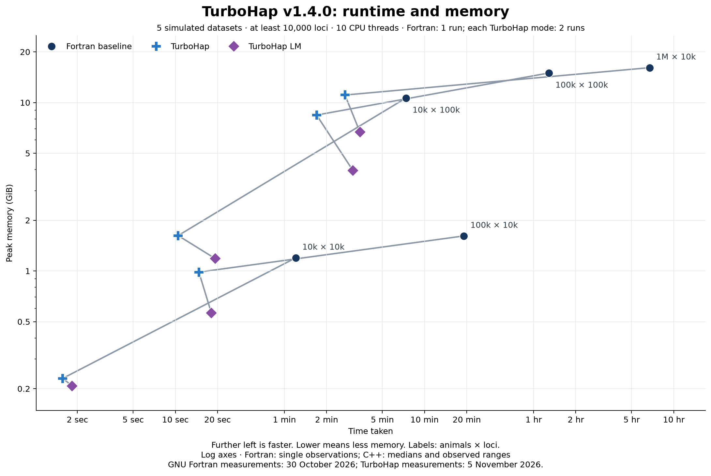
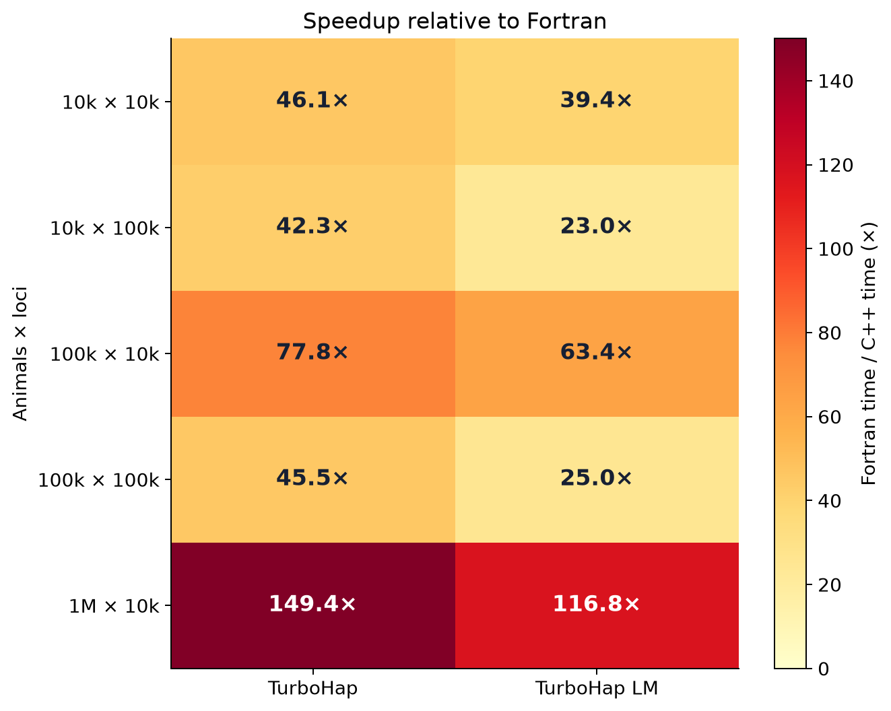
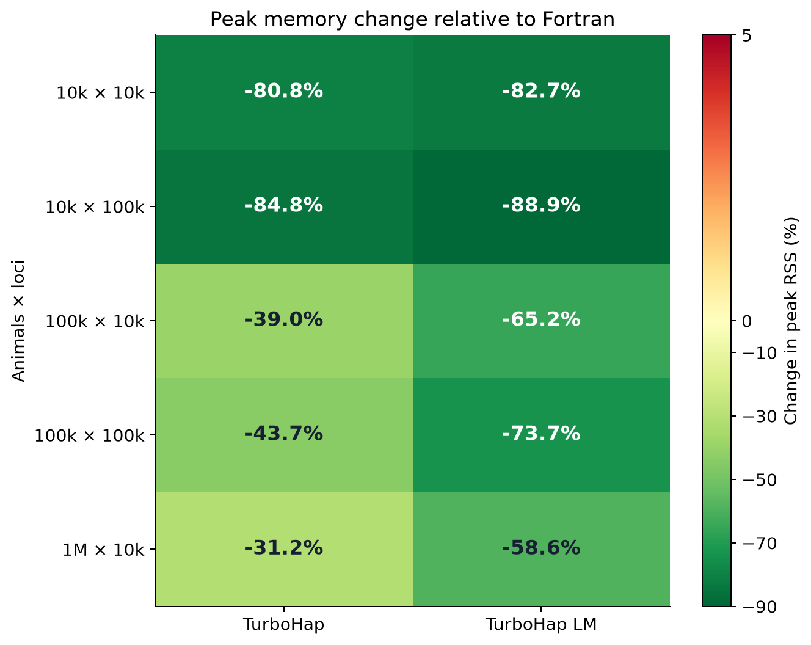

# TurboHap v1.4.0 benchmarks

5 synthetic datasets, each with at least 10,000 loci; one Fortran measurement and two measurements per TurboHap mode and dataset. GNU Fortran measurements: 30 October 2026; TurboHap measurements: 5 November 2026.

The 25 selected observations combine the unchanged GNU Fortran baseline with the current TurboHap measurements. The GNU Fortran baseline uses expanded compiler flags with no taskset or added binding. It has one observation per dataset; no second replicate is included. Historical software-release results remain available separately.

Fortran values are single observations; TurboHap values are medians of two technical runs per mode. Runtime and RSS medians are calculated independently. Bold marks the lowest recorded runtime or RSS and its corresponding ratio, not statistical significance. No Fortran variation estimate is available yet.

### Runtime

Speedup uses the unchanged single expanded-flag Fortran measurement and the median of two TurboHap measurements per mode. GNU Fortran measurements: 30 October 2026; TurboHap measurements: 5 November 2026.

| Animals × loci | Fortran baseline | TurboHap | Speedup | TurboHap LM | Speedup |
| --- | ---: | ---: | ---: | ---: | ---: |
| 10,000 × 10,000 | 1m 12s | **1.57s** | **46.1×** | 1.83s | 39.4× |
| 10,000 × 100,000 | 7m 22s | **10.46s** | **42.3×** | 19.25s | 23.0× |
| 100,000 × 10,000 | 19m 05s | **14.71s** | **77.8×** | 18.07s | 63.4× |
| 100,000 × 100,000 | 1h 17m 08s | **1m 42s** | **45.5×** | 3m 05s | 25.0× |
| 1,000,000 × 10,000 | 6h 44m 06s | **2m 42s** | **149.4×** | 3m 28s | 116.8× |

### Peak memory

Negative percentages mean less memory than Fortran.

| Animals × loci | Fortran baseline | TurboHap | Memory change | TurboHap LM | Memory change |
| --- | ---: | ---: | ---: | ---: | ---: |
| 10,000 × 10,000 | 1.197 GiB | 0.230 GiB | -80.8% | **0.208 GiB** | **-82.7%** |
| 10,000 × 100,000 | 10.645 GiB | 1.622 GiB | -84.8% | **1.184 GiB** | **-88.9%** |
| 100,000 × 10,000 | 1.614 GiB | 0.984 GiB | -39.0% | **0.562 GiB** | **-65.2%** |
| 100,000 × 100,000 | 14.985 GiB | 8.431 GiB | -43.7% | **3.942 GiB** | **-73.7%** |
| 1,000,000 × 10,000 | 16.116 GiB | 11.084 GiB | -31.2% | **6.676 GiB** | **-58.6%** |

[Download runtime and memory figure (SVG)](assets/turbohap_benchmarks_051126.svg)

[Download speedup figure (SVG)](assets/turbohap_benchmarks_051126_speedup.svg)

[Download memory change figure (SVG)](assets/turbohap_benchmarks_051126_memory.svg)

## Methodology

- Hardware: NVIDIA DGX Spark, 20 logical CPU cores; Ubuntu 24.04, Linux ARM64.
- 10 OpenMP threads for every measured program. GCC and gfortran 13.3.0.
- Fortran flags: `-O3 -march=native -funroll-loops -flto -flto-partition=1to1 -fopenmp -ffp-contract=off -fno-underscoring`. No fast-math or profile-guided optimisation.
- C++ release flags: `-O3 -march=native -funroll-loops -flto -ffp-contract=off -std=gnu++17 -fopenmp`; GNU linking uses `-flto-partition=1to1`. No fast-math or profile-guided optimisation.
- The five selected datasets were generated with genosimV4 and each has at least 10,000 loci; dimensions are genotyped animals × map loci. The two 1,000-locus datasets are outside the current release comparison. Each pedigree also contains four ungenotyped founders. Chip membership and pedigree structure affect work; see the [generation recipe and input checksums](turbohap_benchmark_datasets_221026.md).
- Wall time covers the complete executable, including reading inputs, computation, writing results and temporary-file I/O. Output validation is outside the timer.
- Peak memory is process peak resident set size from GNU `time`, converted from KiB to GiB. It is not total system memory, filesystem cache or disk usage.
- Measurement order: Per dataset: standard-1, LM-1, LM-2, standard-2, in ascending animal count then locus count. Fortran observations are reused unchanged from 30 October 2026.
- Both C++ modes use the default automatic CPU policy: the full 20-core container allocation is available, and the launcher selects the ten Cortex-X925 cores (logical IDs 5–9 and 15–19). No taskset or additional worker binding is used. The unchanged Fortran runs had access to all 20 cores with ten threads, no taskset and no added binding. Both C++ modes use `LC_ALL=C`, `OMP_NUM_THREADS=10` and `OMP_DYNAMIC=FALSE`; explicit placement variables are unset.
- All primary elapsed times use GNU time (%e), excluding measurement-wrapper overhead. Fortran wrapper wall time is retained separately in the raw observations. Studies used different sessions and the placement policies above.
- The measured source and executable identities are retained in the JSON metadata. The release packages the qualified implementation with the project-version metadata updated to v1.4.0. The packaged release built successfully and passed all 41 executed regression tests. 2 optional tests were explicitly skipped; see the qualification metadata for their scope. Every benchmark input matches its published SHA-256 and byte count, including the million-animal benchmark options.
- Inputs were explicitly warmed and residency checked before each timed C++ run. There were no inference warmup runs or forced cache eviction. Outputs were fresh; post-exit checked file/directory fsync and hashing occurred outside the timer. Fortran inputs were verified before its study, with no forced cache eviction or inference warmups. No competing benchmark was intentionally run; unrelated background activity was not comprehensively traced. One Fortran observation and two C++ technical repeats do not establish confidence intervals, statistical equivalence or universal speedup.
- All 200 C++ raw-file checks pass. Fortran passes 45/50 raw-file checks: only cross.overs record order differs. Its header and every complete record match after C-locale sorting with duplicates retained. These 5 raw mismatches remain explicit; no other difference is accepted.

[All observations (CSV)](turbohap_benchmarks_051126.csv) · [Metadata and observations (JSON)](turbohap_benchmarks_051126.json) · [Raw output checks](turbohap_validation_051126.json) · [Compatibility](COMPATIBILITY.md)

[Historical v1.2.0 benchmarks](turbohap_benchmarks_301026.md) · [Historical v1.1.0 benchmarks](turbohap_benchmarks_281026.md) · [Historical v1.0.0 benchmarks](turbohap_benchmarks_221026.md). The manuscript and supplementary files continue to describe v1.0.0; they have not been revised for this software release.

## Regenerate the tables and figures

With Python 3.11 or newer and the versions in `tools/requirements-reporting.txt` installed, run `python3 tools/render_benchmarks.py` from the source directory. This reads the included aggregate JSON and validation metadata; it does not access input genotypes or run either program.

The same renderer updates the README headline, performance summary and release notes. See [release preparation](RELEASING.md) for complete-package checks and checksums.
