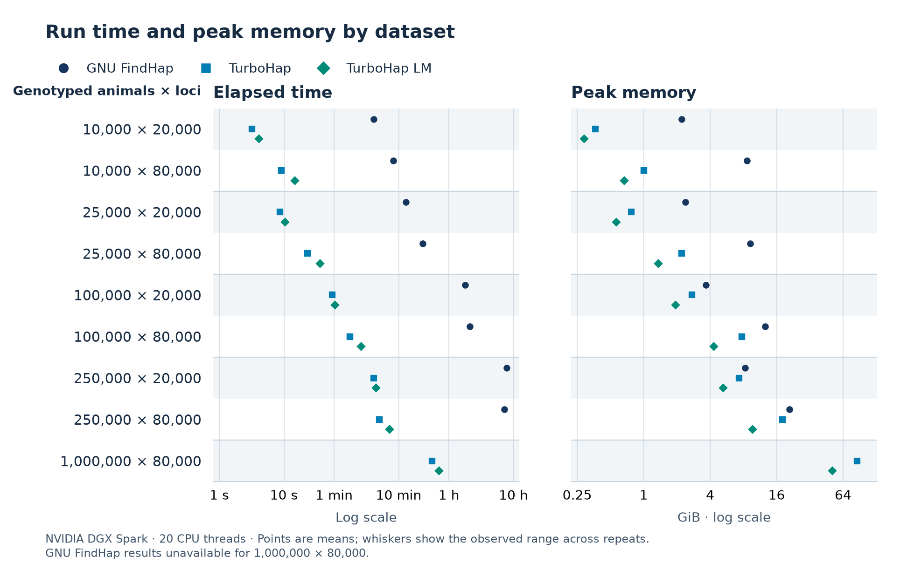
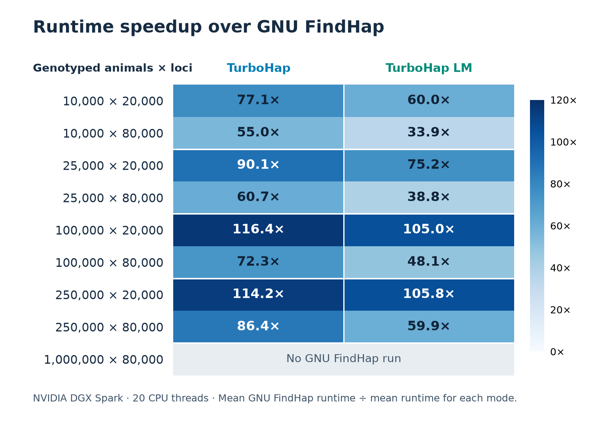
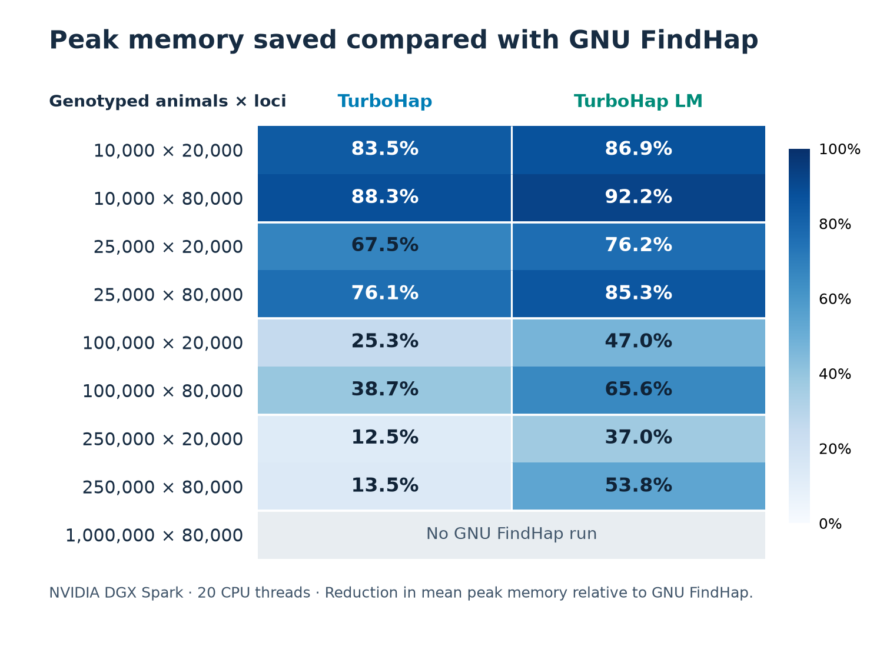

# TurboHap v1.5.0 benchmark results

This comparison includes **36 TurboHap measurements**, **14 GNU FindHap measurements** and **360 passing raw TurboHap output-file checks**. The largest completed matched-control speedup is **116.4×**; the largest measured memory reduction is **92.2%**. All eight planned FindHap controls are complete. No FindHap control is planned for 1,000,000 × 80,000 because of time and resource limits.

### Runtime

| Genotyped animals × loci | GNU FindHap | TurboHap | Speedup | TurboHap LM | Speedup |
| --- | --- | --- | --- | --- | --- |
| 10,000 × 20,000 | 4m 04s | 3.17 s | 77.1× | 4.07 s | 60.0× |
| 10,000 × 80,000 | 8m 19s | 9.08 s | 55.0× | 14.71 s | 33.9× |
| 25,000 × 20,000 | 12m 58s | 8.64 s | 90.1× | 10.35 s | 75.2× |
| 25,000 × 80,000 | 23m 26s | 23.16 s | 60.7× | 36.28 s | 38.8× |
| 100,000 × 20,000 | 1h 47m 57s | 55.63 s | 116.4× | 1m 02s | 105.0× |
| 100,000 × 80,000 | 2h 6m 40s | 1m 45s | 72.3× | 2m 38s | 48.1× |
| 250,000 × 20,000 | 7h 47m 53s | 4m 06s | 114.2× | 4m 25s | 105.8× |
| 250,000 × 80,000 | 7h 11m 03s | 4m 59s | 86.4× | 7m 12s | 59.9× |
| 1,000,000 × 80,000 | Not run | 32m 47s | — | 42m 26s | — |

### Peak memory

Memory in GiB; reductions are relative to GNU FindHap.

| Genotyped animals × loci | GNU FindHap | TurboHap | Reduction | TurboHap LM | Reduction |
| --- | --- | --- | --- | --- | --- |
| 10,000 × 20,000 | 2.213 | 0.364 | 83.5% | 0.289 | 86.9% |
| 10,000 × 80,000 | 8.577 | 1.006 | 88.3% | 0.670 | 92.2% |
| 25,000 × 20,000 | 2.385 | 0.774 | 67.5% | 0.568 | 76.2% |
| 25,000 × 80,000 | 9.243 | 2.206 | 76.1% | 1.360 | 85.3% |
| 100,000 × 20,000 | 3.669 | 2.740 | 25.3% | 1.944 | 47.0% |
| 100,000 × 80,000 | 12.591 | 7.720 | 38.7% | 4.326 | 65.6% |
| 250,000 × 20,000 | 8.325 | 7.288 | 12.5% | 5.249 | 37.0% |
| 250,000 × 80,000 | 20.893 | 18.081 | 13.5% | 9.646 | 53.8% |
| 1,000,000 × 80,000 | Not run | 85.328 | — | 51.259 | — |

## Datasets, settings and repetition

These simulated dairy cattle cohorts use real cattle chromosome lengths and public SNP-chip maps, structured pedigrees, linkage and mixed-density genotyping. They are more realistic and more challenging than the older release datasets. They are different workloads: these times should not be read as a direct speed comparison with v1.4.0. See the [dataset recipe](SYNTHETIC_DATASETS.md). Neither the datasets nor their generation code is included in this release.

The exact inputs for all nine benchmarks are available on Zenodo. [Dataset DOI 10.5281/zenodo.24144449](https://doi.org/10.5281/zenodo.24144449)

| Genotyped animals × loci | maxhap (all programs) | Observed peak live haplotypes | TurboHap + LM repeats | GNU repeats completed |
| --- | --- | --- | --- | --- |
| 10,000 × 20,000 | 50,000 | 7,204 | 2 + 2 | 2 |
| 10,000 × 80,000 | 50,000 | 4,170 | 2 + 2 | 2 |
| 25,000 × 20,000 | 50,000 | 15,458 | 2 + 2 | 2 |
| 25,000 × 80,000 | 50,000 | 7,899 | 2 + 2 | 2 |
| 100,000 × 20,000 | 60,000 | 55,564 | 2 + 2 | 2 |
| 100,000 × 80,000 | 50,000 | 26,039 | 2 + 2 | 2 |
| 250,000 × 20,000 | 130,000 | 120,124 | 2 + 2 | 1 |
| 250,000 × 80,000 | 60,000 | 52,936 | 2 + 2 | 1 |
| 1,000,000 × 80,000 | 170,000 | 167,248 | 2 + 2 | Not run |

All runs use 20 threads and the same options for each dataset: four iterations, XChrom=0, maxlen=100, minlen=50, three segment-length steps, errate=0.004 and all ten outputs enabled. The error-tolerance option is not the simulated genotype error rate. maxlen and minlen count loci, not physical bases. The capacity values above are shared between programs; they are capacity limits, not numbers of retained haplotypes.

Two technical repetitions per TurboHap mode are included throughout. GNU FindHap has two repetitions for 10k, 25k and 100k cohorts, and one for each 250k cohort. Tables use arithmetic means calculated separately for runtime and memory; whiskers show observed minima and maxima, not confidence intervals. Two repeats do not establish universal speedups or statistical equivalence.

## Measurement method

- Hardware: NVIDIA DGX Spark; NVIDIA GB10 CPU, 10 Cortex-X925 performance and 10 Cortex-A725 efficiency cores; 128 GB unified memory; internal NVMe working storage; CPU execution only. The GPU is not used.
- Compiler/runtime: GCC/gfortran 13.3.0 with libgomp. C++ flags: `-O3 -march=native -funroll-loops -flto -flto-partition=1to1 -ffp-contract=off -fopenmp`. GNU Fortran flags: `-O3 -march=native -funroll-loops -flto -flto-partition=1to1 -ffp-contract=off -fopenmp -fno-underscoring`. No fast-math or profile-guided optimisation.
- Measurements use complete executable elapsed time and process peak RSS from GNU time. RSS is reported in KiB in the CSV and divided by 1,048,576 for GiB. Reading, computation, buffered writing and LM scratch activity are inside the timer. Container startup, compilation, input warming, external fsync, output verification and archival are outside it.
- Input and working-output files are on the internal NVMe SSD. Passing retained copies are archived to external storage after measurement. Runs are sequential; inputs are verified and warmed; output directories are fresh. All selected runs exited successfully without swaps.
- Both programs request 20 workers with OMP_NUM_THREADS=20, OMP_DYNAMIC=FALSE and LC_ALL=C. No external taskset or added binding is used. TurboHap uses its automatic heterogeneous-core row scheduler on the Spark; GNU uses its own normal scheduling. At 20 workers both performance and efficiency cores are available.
- TurboHap runs standard then LM in the first repetition and LM then standard in the second. GNU observations were collected in separate sessions. Technical repeats do not represent independent simulated populations.
- Timed runs used modern STDOUT. Release builds default to legacy STDOUT. Use `--stdout=modern` to reproduce the timed console mode. Both modes passed the exact-output checks in [release qualification](RELEASE_CHECKS.md).

## Output verification

All 360 TurboHap checks compare raw file sizes and SHA-256 hashes against retained qualified references, without normalization. The 14 completed GNU runs passed all 140 checks: 126 raw file matches and 14 established crossover record-order exceptions. For cross.overs only, the header and complete records are compared with duplicates retained; the unsorted raw mismatch is not relabelled as byte identity. No other difference is accepted.

The million-animal observation is a TurboHap capacity/performance demonstration, with no claimed FindHap speedup. See [compatibility](COMPATIBILITY.md).

[Individual observations (CSV)](turbohap_benchmarks_111126.csv) · [Aggregate evidence and verification statuses (JSON)](turbohap_benchmarks_111126.json)

## Regenerate the presentation

Install the pinned dependencies in `tools/requirements-reporting.txt`, then run `python3 tools/render_benchmarks.py`. The renderer uses the included aggregate evidence. Run `python3 tools/check_release.py --root . --release` to verify the figures, tables and package.
