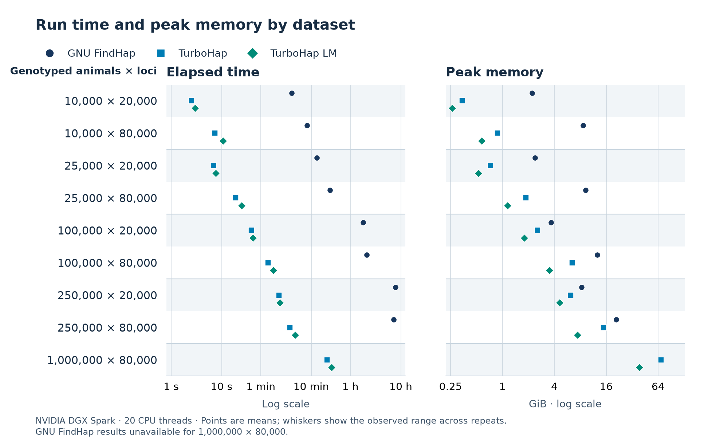
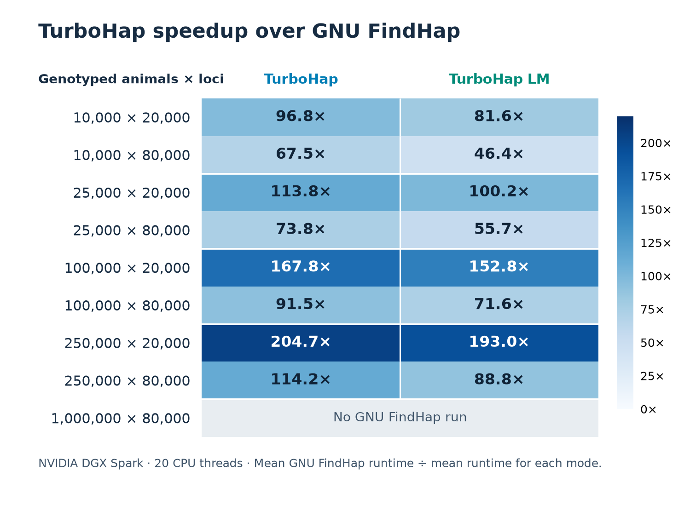
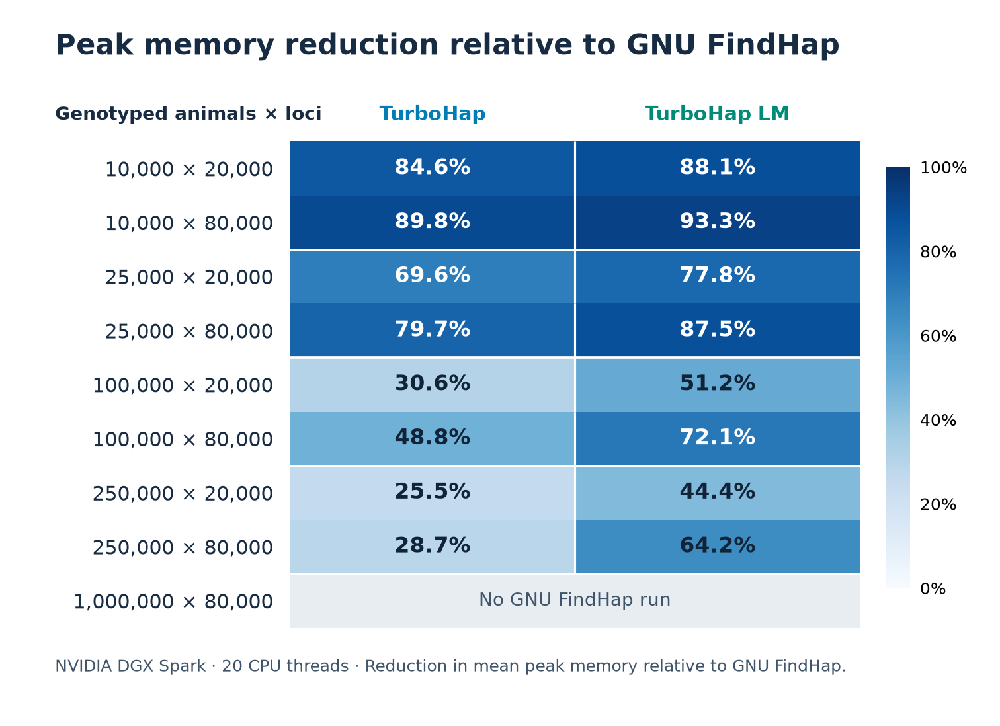

# TurboHap v1.6.0 benchmark results

The two TurboHap modes completed **36 timed runs** on nine datasets and passed **360 byte-for-byte output checks**. Using the 14 GNU FindHap controls published with v1.5.0, the largest measured speedup was **204.7×** and the largest peak memory reduction was **93.3%**. The million-animal dataset has TurboHap results only.

### Runtime

| Genotyped animals × loci | GNU FindHap | TurboHap | Speedup | TurboHap LM | Speedup |
| --- | --- | --- | --- | --- | --- |
| 10,000 × 20,000 | 4m 04s | 2.52 s | 96.8× | 3.00 s | 81.6× |
| 10,000 × 80,000 | 8m 19s | 7.39 s | 67.5× | 10.75 s | 46.4× |
| 25,000 × 20,000 | 12m 58s | 6.84 s | 113.8× | 7.77 s | 100.2× |
| 25,000 × 80,000 | 23m 26s | 19.06 s | 73.8× | 25.24 s | 55.7× |
| 100,000 × 20,000 | 1h 47m 57s | 38.59 s | 167.8× | 42.38 s | 152.8× |
| 100,000 × 80,000 | 2h 6m 40s | 1m 23s | 91.5× | 1m 46s | 71.6× |
| 250,000 × 20,000 | 7h 47m 53s | 2m 17s | 204.7× | 2m 25s | 193.0× |
| 250,000 × 80,000 | 7h 11m 03s | 3m 46s | 114.2× | 4m 51s | 88.8× |
| 1,000,000 × 80,000 | Not run | 20m 28s | — | 25m 43s | — |

### Peak memory

Memory in GiB; reductions are relative to GNU FindHap.

| Genotyped animals × loci | GNU FindHap | TurboHap | Reduction | TurboHap LM | Reduction |
| --- | --- | --- | --- | --- | --- |
| 10,000 × 20,000 | 2.213 | 0.340 | 84.6% | 0.263 | 88.1% |
| 10,000 × 80,000 | 8.577 | 0.875 | 89.8% | 0.577 | 93.3% |
| 25,000 × 20,000 | 2.385 | 0.724 | 69.6% | 0.530 | 77.8% |
| 25,000 × 80,000 | 9.243 | 1.877 | 79.7% | 1.153 | 87.5% |
| 100,000 × 20,000 | 3.669 | 2.546 | 30.6% | 1.791 | 51.2% |
| 100,000 × 80,000 | 12.591 | 6.444 | 48.8% | 3.510 | 72.1% |
| 250,000 × 20,000 | 8.325 | 6.206 | 25.5% | 4.627 | 44.4% |
| 250,000 × 80,000 | 20.893 | 14.887 | 28.7% | 7.482 | 64.2% |
| 1,000,000 × 80,000 | Not run | 69.382 | — | 38.885 | — |

## Datasets and settings

The same nine synthetic cattle datasets were used for v1.5.0 and v1.6.0. They model chromosome lengths, SNP-chip marker positions, pedigrees, linkage, overlapping genotyping panels, missing calls and calling errors. See the [dataset methods](SYNTHETIC_DATASETS.md).

The exact inputs for all nine benchmarks are available on Zenodo. [Dataset DOI 10.5281/zenodo.24144449](https://doi.org/10.5281/zenodo.24144449)

| Genotyped animals × loci | maxhap (all programs) | Peak live haplotypes | Standard + LM repeats | Historical GNU repeats |
| --- | --- | --- | --- | --- |
| 10,000 × 20,000 | 50,000 | 7,204 | 2 + 2 | 2 |
| 10,000 × 80,000 | 50,000 | 4,170 | 2 + 2 | 2 |
| 25,000 × 20,000 | 50,000 | 15,458 | 2 + 2 | 2 |
| 25,000 × 80,000 | 50,000 | 7,899 | 2 + 2 | 2 |
| 100,000 × 20,000 | 60,000 | 55,564 | 2 + 2 | 2 |
| 100,000 × 80,000 | 50,000 | 26,039 | 2 + 2 | 2 |
| 250,000 × 20,000 | 130,000 | 120,124 | 2 + 2 | 1 |
| 250,000 × 80,000 | 60,000 | 52,936 | 2 + 2 | 1 |
| 1,000,000 × 80,000 | 170,000 | 167,248 | 2 + 2 | Not run |

Each run requests 20 CPU threads. The input options specify four iterations, XChrom=0, maximum and minimum segment lengths of 100 and 50 loci, three segment-length stages, errate=0.004 and all ten outputs. The inference error tolerance and the simulated call-error rate have separate meanings. The maxhap setting is the per-segment capacity. The live count is the largest observed library before pruning. These runs use the default genome-wide scope and legacy X-progeny rule.

## Timing and memory

- **Hardware.** NVIDIA DGX Spark; NVIDIA GB10 CPU, 10 Cortex-X925 performance and 10 Cortex-A725 efficiency cores; 128 GB unified memory; internal NVMe working storage; CPU execution only.
- **Build.** GCC/gfortran 13.3.0 with libgomp. We timed the TurboHap v1.6.0 inference engine, compiled with `-O3 -march=native -funroll-loops -flto -ffp-contract=off -std=gnu++17 -fopenmp`. The published GNU Fortran controls used `-O3 -march=native -funroll-loops -flto -flto-partition=1to1 -ffp-contract=off -fopenmp -fno-underscoring`. The release comparison uses the published v1.5.0 TurboHap build and the same GNU controls.

The v1.6.0 jobs ran consecutively on the host, in fresh output directories on internal NVMe storage. Dataset inputs were warmed before timing. Standard ran first in repeat one and LM first in repeat two. The historical v1.5.0 TurboHap and GNU FindHap jobs ran in separate container sessions on the same Spark. All programs used OMP_NUM_THREADS=20 and OMP_DYNAMIC=FALSE. TurboHap used automatic CPU placement and modern progress output.

GNU time measured elapsed seconds and peak process RSS through program exit. The timer includes input, calculation, buffered output and LM scratch I/O. Compilation, cache warming, verification and archival took place outside the timer. One GiB equals 1,048,576 KiB.

Both million-animal Standard repeats coincided with host swap activity. The system read/wrote 11.99/12.75 GiB and 4.98/6.88 GiB in repeats one and two respectively. These host-wide counters include all processes and are reported in the CSV alongside elapsed time. Peak RSS counts resident process memory. It excludes swapped-out pages and filesystem cache outside the process.

Tables show arithmetic means of the repetitions for each dataset, mode and metric. Whiskers show the observed range of technical repetitions. GNU FindHap has two historical repeats per dataset through 100,000 animals and one per 250,000-animal dataset. The million-animal GNU control was omitted because of the time and memory required. The results describe these workloads and machine.

## Output verification

All 360 TurboHap output files matched their qualified references in raw size, SHA-256 and direct byte comparisons. The 14 published GNU FindHap runs had 126 raw file matches. In the other 14 comparisons, the cross.overs header and the complete set of records, including duplicates, matched after allowing for record order. See [output compatibility](COMPATIBILITY.md).

[Current measurements and historical GNU controls (CSV)](turbohap_benchmarks_201126.csv) · [Aggregate evidence, v1.5.0 comparison inputs and verification results (JSON)](turbohap_benchmarks_201126.json) · [Changes relative to v1.5.0](turbohap_release_comparison_201126.md) · [Performance across seven releases](turbohap_release_history_201126.md)

The CSV contains each timed run. The JSON also records the benchmark settings, output checks and measurements used for the v1.5.0 comparison.
