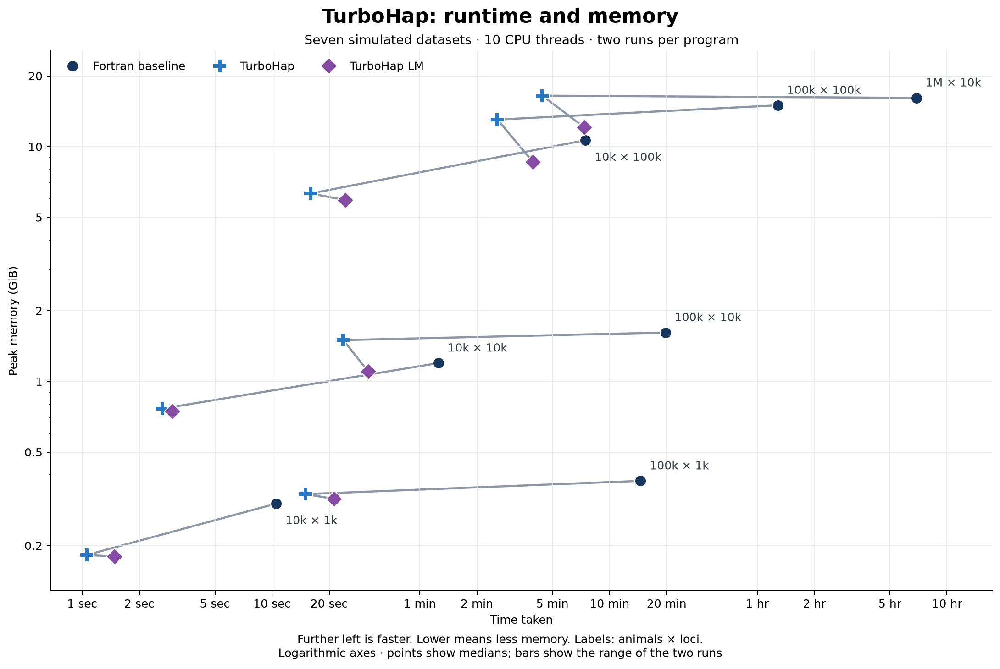
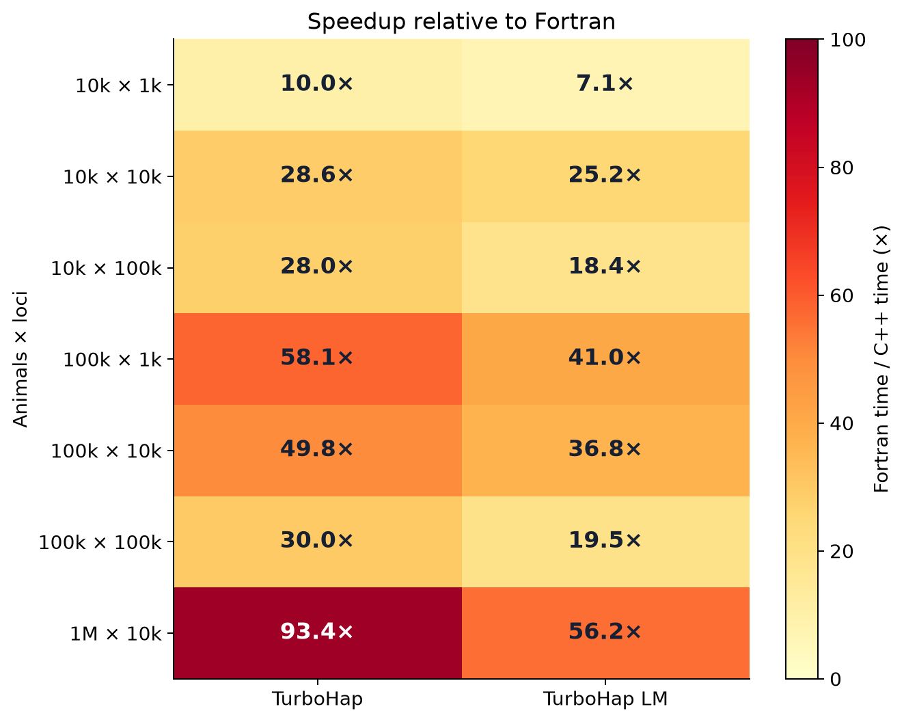
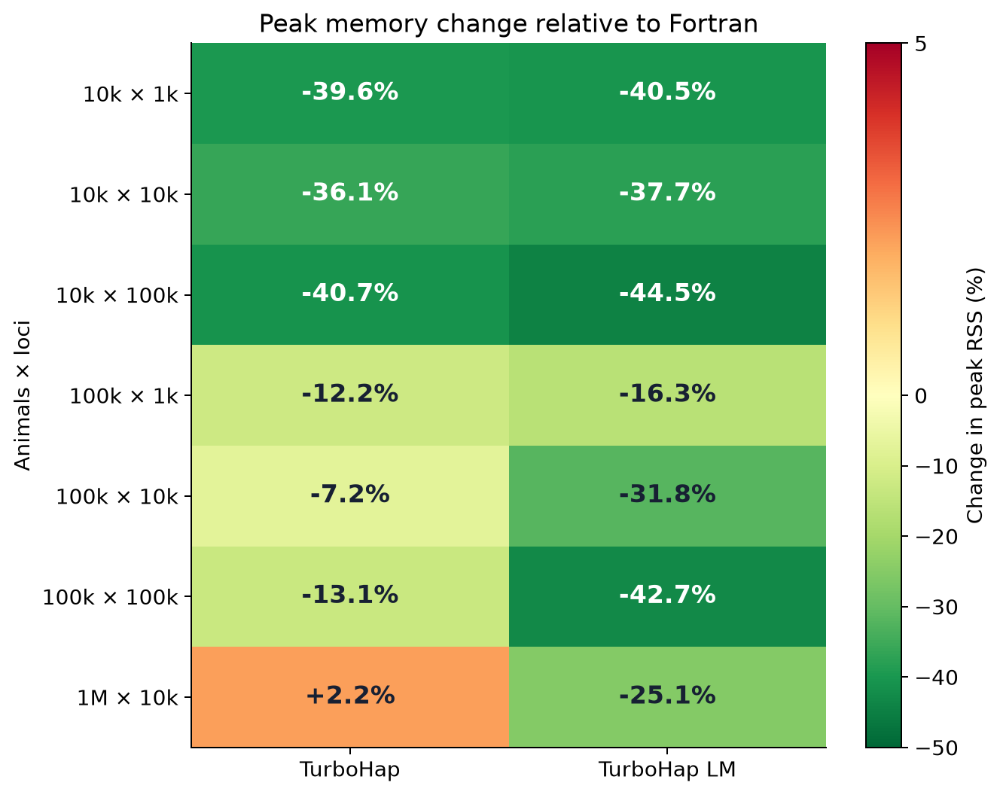

# TurboHap benchmarks

22 October 2026. Seven synthetic datasets; two measurements per program and dataset.

Values are medians of two runs for each program.

### Runtime

Speedup is relative to the original Fortran baseline.

| Animals × loci | Fortran baseline | TurboHap | Speedup | TurboHap LM | Speedup |
| --- | ---: | ---: | ---: | ---: | ---: |
| 10,000 × 1,000 | 10.52s | **1.06s** | **10.0×** | 1.49s | 7.1× |
| 10,000 × 10,000 | 1m 16s | **2.64s** | **28.6×** | 2.99s | 25.2× |
| 10,000 × 100,000 | 7m 28s | **15.99s** | **28.0×** | 24.32s | 18.4× |
| 100,000 × 1,000 | 14m 34s | **15.04s** | **58.1×** | 21.33s | 41.0× |
| 100,000 × 10,000 | 19m 42s | **23.74s** | **49.8×** | 32.15s | 36.8× |
| 100,000 × 100,000 | 1h 17m 00s | **2m 34s** | **30.0×** | 3m 57s | 19.5× |
| 1,000,000 × 10,000 | 6h 53m 40s | **4m 26s** | **93.4×** | 7m 22s | 56.2× |

### Peak memory

Negative percentages mean less memory than Fortran.

| Animals × loci | Fortran baseline | TurboHap | Memory change | TurboHap LM | Memory change |
| --- | ---: | ---: | ---: | ---: | ---: |
| 10,000 × 1,000 | 0.302 GiB | 0.182 GiB | -39.6% | **0.180 GiB** | **-40.5%** |
| 10,000 × 10,000 | 1.197 GiB | 0.765 GiB | -36.1% | **0.746 GiB** | **-37.7%** |
| 10,000 × 100,000 | 10.645 GiB | 6.312 GiB | -40.7% | **5.910 GiB** | **-44.5%** |
| 100,000 × 1,000 | 0.377 GiB | 0.331 GiB | -12.2% | **0.316 GiB** | **-16.3%** |
| 100,000 × 10,000 | 1.615 GiB | 1.499 GiB | -7.2% | **1.101 GiB** | **-31.8%** |
| 100,000 × 100,000 | 14.985 GiB | 13.025 GiB | -13.1% | **8.581 GiB** | **-42.7%** |
| 1,000,000 × 10,000 | 16.117 GiB | 16.472 GiB | +2.2% | **12.077 GiB** | **-25.1%** |

[Download runtime and memory figure (SVG)](assets/turbohap_benchmarks_221026.svg)

[Download speedup figure (SVG)](assets/turbohap_benchmarks_221026_speedup.svg)

[Download memory change figure (SVG)](assets/turbohap_benchmarks_221026_memory.svg)

## Methodology

- Hardware: NVIDIA DGX Spark; 20 logical CPU cores; Ubuntu 24.04 ARM64.
- Ten OpenMP threads for every measured program. GCC/gfortran 13.3.0.
- Original Fortran flags: `-O3 -fopenmp -fno-underscoring`.
- C++ release flags: `-O3 -march=native -funroll-loops -flto -std=gnu++17 -fopenmp`; GNU linking uses `-flto-partition=1to1`.
- The seven datasets were generated with genosimV4; dimensions are genotyped animals × map loci. Each pedigree also contains four ungenotyped founders. Chip membership and pedigree structure affect work; see the [generation recipe and input checksums](turbohap_benchmark_datasets_221026.md).
- Wall time covers the complete executable, including reading inputs, computation, writing results and temporary-file I/O. Output validation is outside the timer.
- Peak memory is process peak resident set size from GNU `time`, converted from KiB to GiB. It is not total system memory, filesystem cache or disk usage.
- Each program was measured twice on 21–22 October 2026 using matching datasets, options and ten threads. Execution order per dataset was Fortran, TurboHap, LM, LM, TurboHap, Fortran. Tables show medians; the two C++ modes use one combined executable.
- Measurements use the release C++ source identified by file hashes in the metadata. The seven datasets passed marker-location, genotype/phase and parental-sex validation before timing.
- There were no warmup runs or forced cache eviction. The server also ran other work; competing load was not systematically measured or controlled. Two repeats do not establish narrow confidence intervals or universal speedup.
- Every C++ output passes its saved reference check. All result bytes match; Fortran comparisons allow only complete crossover-record ordering to differ. C++ mode comparisons are strict, including crossover order.

[All observations (CSV)](turbohap_benchmarks_221026.csv) · [Metadata and observations (JSON)](turbohap_benchmarks_221026.json) · [Compatibility](COMPATIBILITY.md)

## Regenerate the tables and figures

With Python 3, NumPy and Matplotlib installed, run `python3 tools/render_benchmarks.py` from the source directory. This reads the included aggregate JSON and does not access input genotypes or run either program.
