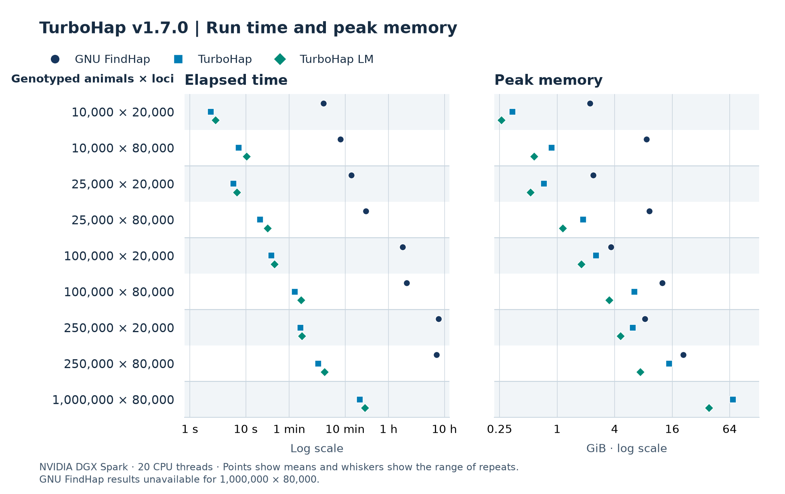
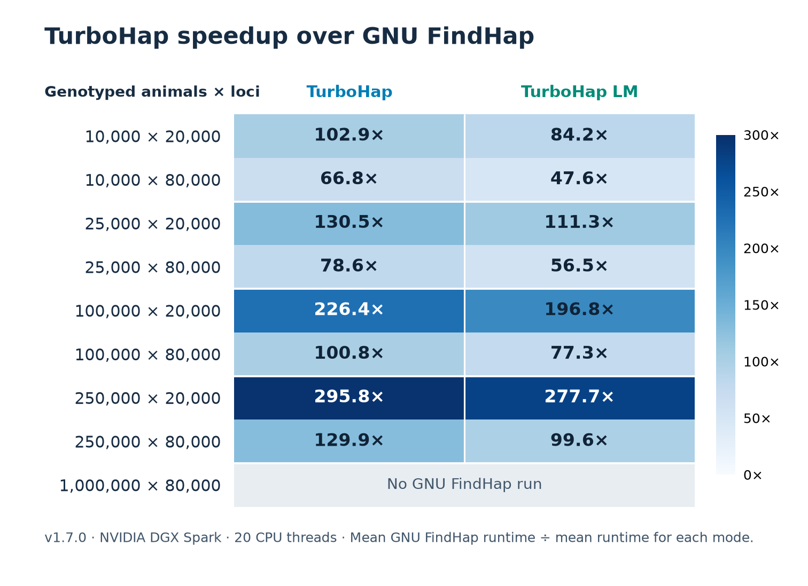
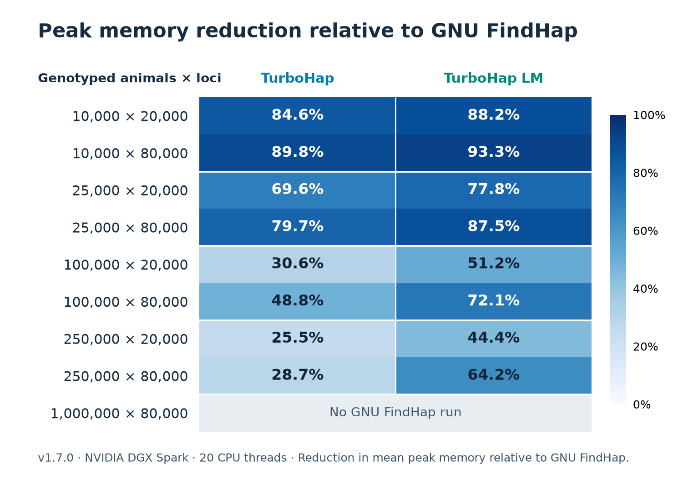

# TurboHap v1.7.0 benchmark results

On the 250,000-animal, 20,000-locus dataset, TurboHap ran **295.8× faster** than GNU FindHap. The largest reduction in peak memory against GNU FindHap was **93.3%**. Both TurboHap modes ran twice on each of nine datasets.

### Runtime

| Genotyped animals × loci | GNU FindHap | TurboHap | Speedup | TurboHap LM | Speedup |
| --- | --- | --- | --- | --- | --- |
| 10,000 × 20,000 | 4m 04s | 2.38 s | 102.9× | 2.90 s | 84.2× |
| 10,000 × 80,000 | 8m 19s | 7.47 s | 66.8× | 10.48 s | 47.6× |
| 25,000 × 20,000 | 12m 58s | 5.96 s | 130.5× | 7.00 s | 111.3× |
| 25,000 × 80,000 | 23m 26s | 17.89 s | 78.6× | 24.89 s | 56.5× |
| 100,000 × 20,000 | 1h 47m 57s | 28.61 s | 226.4× | 32.92 s | 196.8× |
| 100,000 × 80,000 | 2h 6m 40s | 1m 15s | 100.8× | 1m 38s | 77.3× |
| 250,000 × 20,000 | 7h 47m 53s | 1m 35s | 295.8× | 1m 41s | 277.7× |
| 250,000 × 80,000 | 7h 11m 03s | 3m 19s | 129.9× | 4m 20s | 99.6× |
| 1,000,000 × 80,000 | Not run | 18m 13s | — | 22m 57s | — |

### Peak memory

Peak process RSS is given in GiB. Reductions are relative to GNU FindHap.

| Genotyped animals × loci | GNU FindHap | TurboHap | Reduction | TurboHap LM | Reduction |
| --- | --- | --- | --- | --- | --- |
| 10,000 × 20,000 | 2.213 | 0.340 | 84.6% | 0.262 | 88.2% |
| 10,000 × 80,000 | 8.577 | 0.875 | 89.8% | 0.577 | 93.3% |
| 25,000 × 20,000 | 2.385 | 0.724 | 69.6% | 0.530 | 77.8% |
| 25,000 × 80,000 | 9.243 | 1.877 | 79.7% | 1.153 | 87.5% |
| 100,000 × 20,000 | 3.669 | 2.547 | 30.6% | 1.792 | 51.2% |
| 100,000 × 80,000 | 12.591 | 6.443 | 48.8% | 3.509 | 72.1% |
| 250,000 × 20,000 | 8.325 | 6.205 | 25.5% | 4.631 | 44.4% |
| 250,000 × 80,000 | 20.893 | 14.887 | 28.7% | 7.482 | 64.2% |
| 1,000,000 × 80,000 | Not run | 69.386 | — | 38.889 | — |

## Speedup and memory saved relative to GNU FindHap

## Datasets and settings

The inputs are the same nine simulated dairy-cattle datasets used for v1.5.0 and v1.6.0. They include incomplete pedigrees, uneven marker spacing, overlapping SNP panels, missing calls and genotyping errors. [Dataset methods](SYNTHETIC_DATASETS.md) · [Archived inputs on Zenodo](https://doi.org/10.5281/zenodo.24144449)

| Genotyped animals × loci | maxhap | Peak live haplotypes | Standard + LM repeats | GNU repeats |
| --- | --- | --- | --- | --- |
| 10,000 × 20,000 | 50,000 | 7,204 | 2 + 2 | 2 |
| 10,000 × 80,000 | 50,000 | 4,170 | 2 + 2 | 2 |
| 25,000 × 20,000 | 50,000 | 15,458 | 2 + 2 | 2 |
| 25,000 × 80,000 | 50,000 | 7,899 | 2 + 2 | 2 |
| 100,000 × 20,000 | 60,000 | 55,564 | 2 + 2 | 2 |
| 100,000 × 80,000 | 50,000 | 26,039 | 2 + 2 | 2 |
| 250,000 × 20,000 | 130,000 | 120,124 | 2 + 2 | 1 |
| 250,000 × 80,000 | 60,000 | 52,936 | 2 + 2 | 1 |
| 1,000,000 × 80,000 | 170,000 | 167,248 | 2 + 2 | Not run |

All runs used 20 CPU threads. The inputs specify four iterations, three segment-length stages, maximum and minimum lengths of 100 and 50 loci, `errate=0.004`, `XChrom=0` and all ten result files. The runs used the default genome-wide analysis. The table distinguishes the configured per-segment capacity (`maxhap`) from the largest number of live haplotypes before pruning.

## Timing and memory

The DGX Spark has an NVIDIA GB10 CPU with ten Cortex-X925 cores and ten Cortex-A725 cores, 128 GB of unified memory and internal NVMe storage. The runs used CPU execution, GNU OpenMP, GCC 13.3.0 for TurboHap and GNU Fortran 13.3.0 for FindHap. The exact compiler flags are recorded in the JSON.

TurboHap ran in fresh working directories, with automatic CPU placement, modern console logging and 20 OpenMP threads. The two modes were run in opposite orders in the two repeats. GNU time measured through process exit, including input, calculation, buffered output and LM scratch I/O. The final disk flush and file checks ran after the timer stopped. One GiB is 1,048,576 KiB.

For v1.7.0 a run was replaced if host swap reads and writes together reached 256 MiB. One 250,000 × 80,000 Standard attempt met that criterion. Its replacement supplies the second observation in the tables. The JSON lists the excluded attempt separately. The published v1.6.0 million-animal Standard runs coincided with host swap activity. For v1.7.0 the benchmark requested eviction of the genotype file from cache before each million-animal Standard run to reduce memory pressure. The other v1.7.0 runs used warmed inputs. The timing differences on that row reflect both the software and the conditions in which the measurements were made.

Tables report arithmetic means. Whiskers show the range of the observed technical repeats. The published v1.5.0 GNU FindHap controls have two runs per dataset through 100,000 animals and one for each 250,000-animal dataset. The million-animal workload has TurboHap measurements only.

## Output verification

All 360 files from the 36 accepted TurboHap runs matched the trusted references in raw size and SHA-256. The 14 GNU FindHap runs on eight datasets had 126 exact file matches. Each of the other 14 files was `cross.overs`. Its header and complete collection of records, including duplicates, matched after allowing for record order. [Output compatibility](COMPATIBILITY.md)

[Individual measurements (CSV)](turbohap_benchmarks_221126.csv) · [Settings, previous measurements and file checks (JSON)](turbohap_benchmarks_221126.json) · [Comparison with v1.6.0](turbohap_release_comparison_221126.md) · [Performance across eight releases](turbohap_release_history_221126.md)
