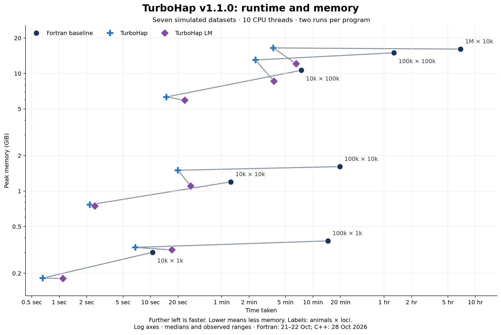
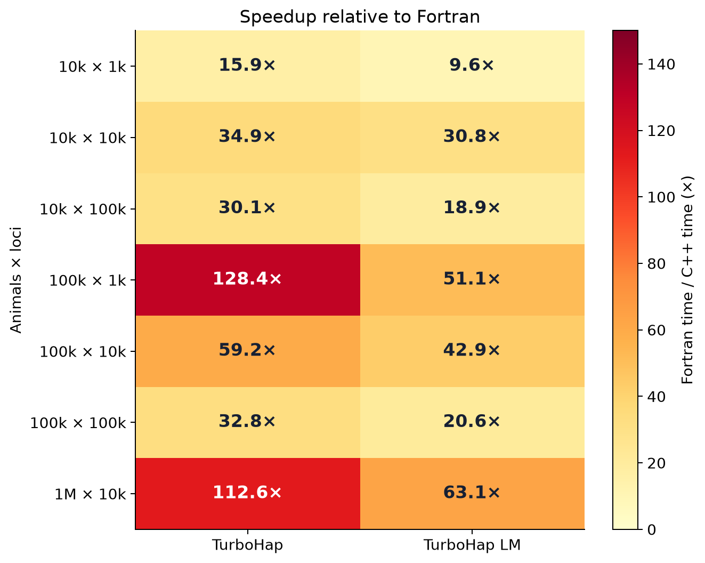
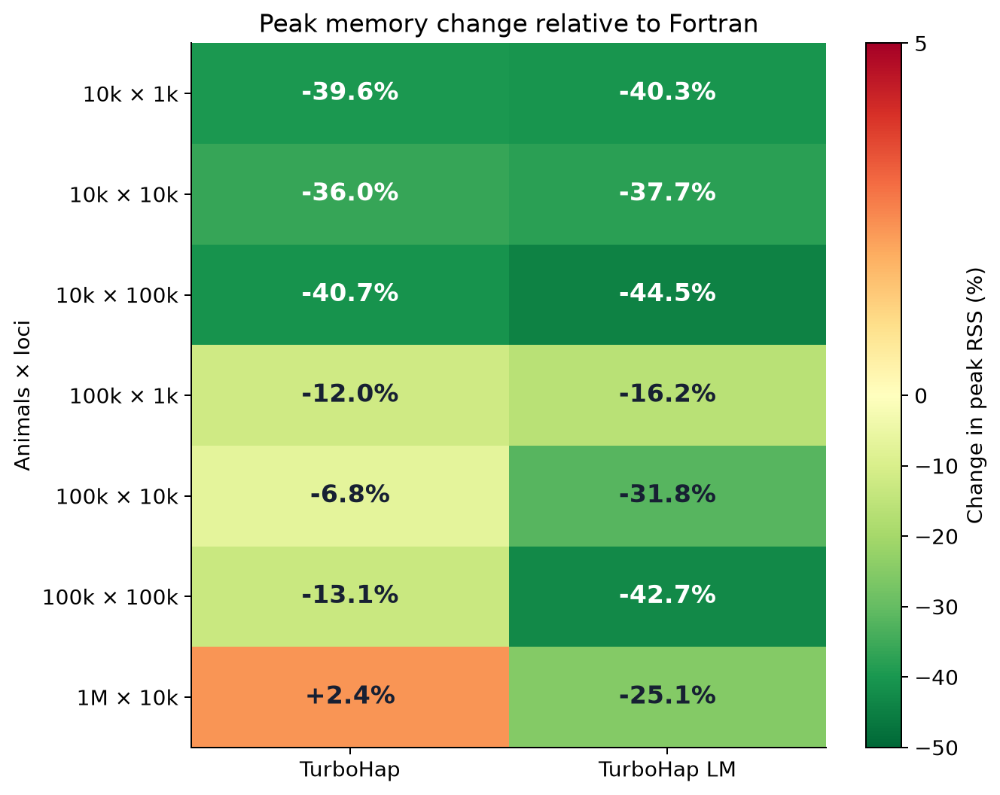

# TurboHap v1.1.0 benchmarks

28 October 2026. Seven synthetic datasets; two measurements per program and dataset.

TurboHap and TurboHap LM were measured on 28 October. The original Fortran observations are retained unchanged from 21–22 October. Ratios against Fortran use that historical baseline; they are not fresh matched Fortran comparisons.

Values are medians of two runs for each program. Runtime and RSS medians are calculated independently. Bold marks the lowest recorded runtime or RSS and its corresponding ratio, not statistical significance.

### Runtime

Speedup is relative to the retained Fortran baseline measured on 21–22 October 2026.

| Animals × loci | Fortran baseline | TurboHap | Speedup | TurboHap LM | Speedup |
| --- | ---: | ---: | ---: | ---: | ---: |
| 10,000 × 1,000 | 10.52s | **0.66s** | **15.9×** | 1.10s | 9.6× |
| 10,000 × 10,000 | 1m 16s | **2.17s** | **34.9×** | 2.46s | 30.8× |
| 10,000 × 100,000 | 7m 28s | **14.89s** | **30.1×** | 23.71s | 18.9× |
| 100,000 × 1,000 | 14m 34s | **6.80s** | **128.4×** | 17.09s | 51.1× |
| 100,000 × 10,000 | 19m 42s | **19.96s** | **59.2×** | 27.55s | 42.9× |
| 100,000 × 100,000 | 1h 17m 00s | **2m 21s** | **32.8×** | 3m 45s | 20.6× |
| 1,000,000 × 10,000 | 6h 53m 40s | **3m 40s** | **112.6×** | 6m 33s | 63.1× |

### Peak memory

Negative percentages mean less memory than Fortran.

| Animals × loci | Fortran baseline | TurboHap | Memory change | TurboHap LM | Memory change |
| --- | ---: | ---: | ---: | ---: | ---: |
| 10,000 × 1,000 | 0.302 GiB | 0.182 GiB | -39.6% | **0.180 GiB** | **-40.3%** |
| 10,000 × 10,000 | 1.197 GiB | 0.766 GiB | -36.0% | **0.746 GiB** | **-37.7%** |
| 10,000 × 100,000 | 10.645 GiB | 6.312 GiB | -40.7% | **5.911 GiB** | **-44.5%** |
| 100,000 × 1,000 | 0.377 GiB | 0.332 GiB | -12.0% | **0.316 GiB** | **-16.2%** |
| 100,000 × 10,000 | 1.615 GiB | 1.504 GiB | -6.8% | **1.102 GiB** | **-31.8%** |
| 100,000 × 100,000 | 14.985 GiB | 13.026 GiB | -13.1% | **8.582 GiB** | **-42.7%** |
| 1,000,000 × 10,000 | 16.117 GiB | 16.496 GiB | +2.4% | **12.078 GiB** | **-25.1%** |

[Download runtime and memory figure (SVG)](assets/turbohap_benchmarks_281026.svg)

[Download speedup figure (SVG)](assets/turbohap_benchmarks_281026_speedup.svg)

[Download memory change figure (SVG)](assets/turbohap_benchmarks_281026_memory.svg)

## Methodology

- Hardware: NVIDIA DGX Spark; 20 logical CPU cores; Ubuntu 24.04 ARM64.
- Ten OpenMP threads for every measured program. GCC/gfortran 13.3.0.
- Original Fortran flags: `-O3 -fopenmp -fno-underscoring`.
- C++ release flags: `-O3 -march=native -funroll-loops -flto -ffp-contract=off -std=gnu++17 -fopenmp`; GNU linking uses `-flto-partition=1to1`. No fast-math or profile-guided optimisation.
- The seven datasets were generated with genosimV4; dimensions are genotyped animals × map loci. Each pedigree also contains four ungenotyped founders. Chip membership and pedigree structure affect work; see the [generation recipe and input checksums](turbohap_benchmark_datasets_221026.md).
- Wall time covers the complete executable, including reading inputs, computation, writing results and temporary-file I/O. Output validation is outside the timer.
- Peak memory is process peak resident set size from GNU `time`, converted from KiB to GiB. It is not total system memory, filesystem cache or disk usage.
- The two v1.1.0 candidate runs per mode/dataset came from a previous-control/candidate/candidate/previous-control comparison. All 28 candidate observations are included. The earlier control observations are not substituted for the retained Fortran baseline.
- C++ threads were restricted to ten Cortex-X925 cores (logical CPU IDs 5–9 and 15–19). The historical Fortran runs had access to all 20 logical cores with ten threads. The environment sets `LC_ALL=C`, `OMP_NUM_THREADS=10` and `OMP_DYNAMIC=FALSE`.
- C++ elapsed times use GNU time (%e), excluding monitoring-wrapper overhead. Historical Fortran timings retain their original wall-clock measurement. These are different sessions, with different affinity and recorded timing precision.
- The C++ source files are byte-identical to the qualified engine; release packaging changes only the CMake project version. Source/build hashes and measured executable identities are included in the JSON metadata. The seven datasets passed marker-location, genotype/phase and parental-sex validation before timing.
- There were no warmup runs or forced cache eviction. The host was made available for the C++ qualification; the older Fortran baseline was measured on a shared server. Two technical repeats do not establish confidence intervals, statistical equivalence or universal speedup.
- Every C++ output passes its saved reference check. All result bytes match; Fortran comparisons allow only complete crossover-record ordering to differ. C++ mode comparisons are strict, including crossover order.

[All observations (CSV)](turbohap_benchmarks_281026.csv) · [Metadata and observations (JSON)](turbohap_benchmarks_281026.json) · [Raw output checks](turbohap_validation_281026.json) · [Compatibility](COMPATIBILITY.md)

[Historical v1.0.0 benchmarks](turbohap_benchmarks_221026.md). The manuscript and supplementary files continue to describe v1.0.0; they have not been revised for this software release.

## Regenerate the tables and figures

With Python 3, NumPy and Matplotlib installed, run `python3 tools/render_benchmarks.py` from the source directory. This reads the included aggregate JSON and does not access input genotypes or run either program.
