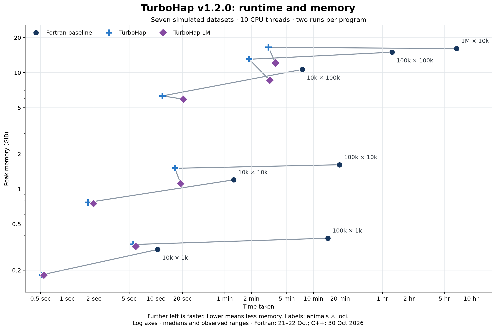
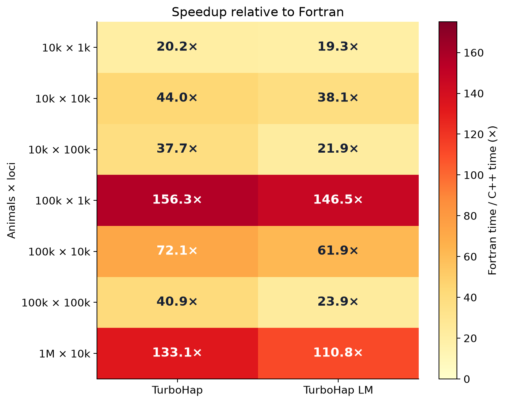
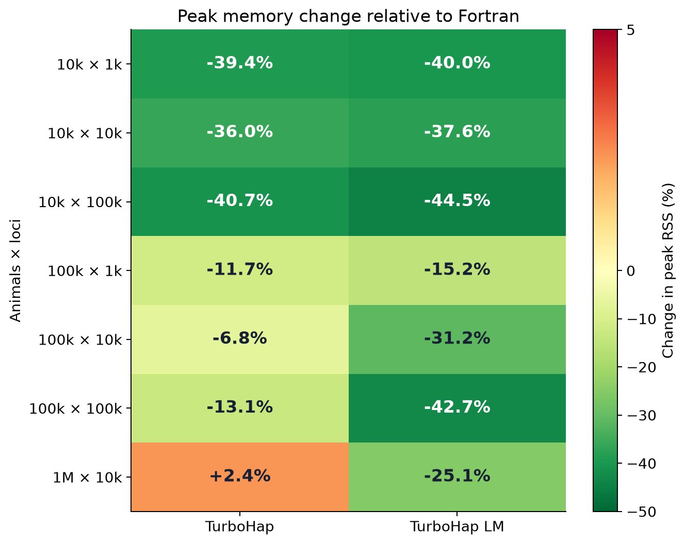

# TurboHap v1.2.0 benchmarks

30 October 2026. Seven synthetic datasets; two measurements per program and dataset.

TurboHap and TurboHap LM were measured on 30 October. The original Fortran observations are retained unchanged from 21–22 October. Ratios against Fortran use that historical baseline; they are not fresh matched Fortran comparisons.

Values are medians of two runs for each program. Runtime and RSS medians are calculated independently. Bold marks the lowest recorded runtime or RSS and its corresponding ratio, not statistical significance.

### Runtime

Speedup is relative to the retained Fortran baseline measured on 21–22 October 2026.

| Animals × loci | Fortran baseline | TurboHap | Speedup | TurboHap LM | Speedup |
| --- | ---: | ---: | ---: | ---: | ---: |
| 10,000 × 1,000 | 10.52s | **0.52s** | **20.2×** | 0.55s | 19.3× |
| 10,000 × 10,000 | 1m 16s | **1.71s** | **44.0×** | 1.98s | 38.1× |
| 10,000 × 100,000 | 7m 28s | **11.91s** | **37.7×** | 20.46s | 21.9× |
| 100,000 × 1,000 | 14m 34s | **5.59s** | **156.3×** | 5.96s | 146.5× |
| 100,000 × 10,000 | 19m 42s | **16.41s** | **72.1×** | 19.09s | 61.9× |
| 100,000 × 100,000 | 1h 17m 00s | **1m 53s** | **40.9×** | 3m 14s | 23.9× |
| 1,000,000 × 10,000 | 6h 53m 40s | **3m 06s** | **133.1×** | 3m 44s | 110.8× |

### Peak memory

Negative percentages mean less memory than Fortran.

| Animals × loci | Fortran baseline | TurboHap | Memory change | TurboHap LM | Memory change |
| --- | ---: | ---: | ---: | ---: | ---: |
| 10,000 × 1,000 | 0.302 GiB | 0.183 GiB | -39.4% | **0.181 GiB** | **-40.0%** |
| 10,000 × 10,000 | 1.197 GiB | 0.766 GiB | -36.0% | **0.747 GiB** | **-37.6%** |
| 10,000 × 100,000 | 10.645 GiB | 6.312 GiB | -40.7% | **5.910 GiB** | **-44.5%** |
| 100,000 × 1,000 | 0.377 GiB | 0.333 GiB | -11.7% | **0.320 GiB** | **-15.2%** |
| 100,000 × 10,000 | 1.615 GiB | 1.505 GiB | -6.8% | **1.111 GiB** | **-31.2%** |
| 100,000 × 100,000 | 14.985 GiB | 13.026 GiB | -13.1% | **8.582 GiB** | **-42.7%** |
| 1,000,000 × 10,000 | 16.117 GiB | 16.496 GiB | +2.4% | **12.079 GiB** | **-25.1%** |

[Download runtime and memory figure (SVG)](assets/turbohap_benchmarks_301026.svg)

[Download speedup figure (SVG)](assets/turbohap_benchmarks_301026_speedup.svg)

[Download memory change figure (SVG)](assets/turbohap_benchmarks_301026_memory.svg)

## Methodology

- Hardware: NVIDIA DGX Spark; 20 logical CPU cores; Ubuntu 24.04 ARM64.
- Ten OpenMP threads for every measured program. GCC/gfortran 13.3.0.
- Original Fortran flags: `-O3 -fopenmp -fno-underscoring`.
- C++ release flags: `-O3 -march=native -funroll-loops -flto -ffp-contract=off -std=gnu++17 -fopenmp`; GNU linking uses `-flto-partition=1to1`. No fast-math or profile-guided optimisation.
- The seven datasets were generated with genosimV4; dimensions are genotyped animals × map loci. Each pedigree also contains four ungenotyped founders. Chip membership and pedigree structure affect work; see the [generation recipe and input checksums](turbohap_benchmark_datasets_221026.md).
- Wall time covers the complete executable, including reading inputs, computation, writing results and temporary-file I/O. Output validation is outside the timer.
- Peak memory is process peak resident set size from GNU `time`, converted from KiB to GiB. It is not total system memory, filesystem cache or disk usage.
- Each dataset used standard-1, LM-1, LM-2, standard-2 order. All 28 new observations are included; Fortran was not rerun.
- Both C++ modes use the default automatic CPU policy: the full 20-core container allocation is available, and the launcher selects the ten Cortex-X925 cores (logical IDs 5–9 and 15–19). No taskset or additional worker binding is used. The historical Fortran runs had access to all 20 cores with ten threads. Both C++ modes use `LC_ALL=C`, `OMP_NUM_THREADS=10` and `OMP_DYNAMIC=FALSE`; explicit placement variables are unset.
- C++ elapsed times use GNU time (%e), excluding monitoring-wrapper overhead. Historical Fortran timings retain their original wall-clock measurement. These are different sessions, with different affinity and recorded timing precision.
- A clean release layout, with CMake project version 1.2.0, was frozen and built before measurement. All 19 packaged tests passed. Source and measured executable hashes are included in the JSON metadata. Every benchmark input matches its published SHA-256 and byte count, including the million-animal benchmark options.
- Inputs were explicitly warmed and residency checked before each timed C++ run. There were no inference warmup runs or forced cache eviction. Outputs were fresh; post-exit checked file/directory fsync and hashing occurred outside the timer. The C++ host was quiet, while the older Fortran baseline was measured on a shared server. Two technical repeats do not establish confidence intervals, statistical equivalence or universal speedup.
- Every C++ output passes its saved reference check. All result bytes match; Fortran comparisons allow only complete crossover-record ordering to differ. C++ mode comparisons are strict, including crossover order.

[All observations (CSV)](turbohap_benchmarks_301026.csv) · [Metadata and observations (JSON)](turbohap_benchmarks_301026.json) · [Raw output checks](turbohap_validation_301026.json) · [Compatibility](COMPATIBILITY.md)

[Historical v1.1.0 benchmarks](turbohap_benchmarks_281026.md) · [Historical v1.0.0 benchmarks](turbohap_benchmarks_221026.md). The manuscript and supplementary files continue to describe v1.0.0; they have not been revised for this software release.

## Regenerate the tables and figures

With Python 3, NumPy and Matplotlib installed, run `python3 tools/render_benchmarks.py` from the source directory. This reads the included aggregate JSON and does not access input genotypes or run either program.
