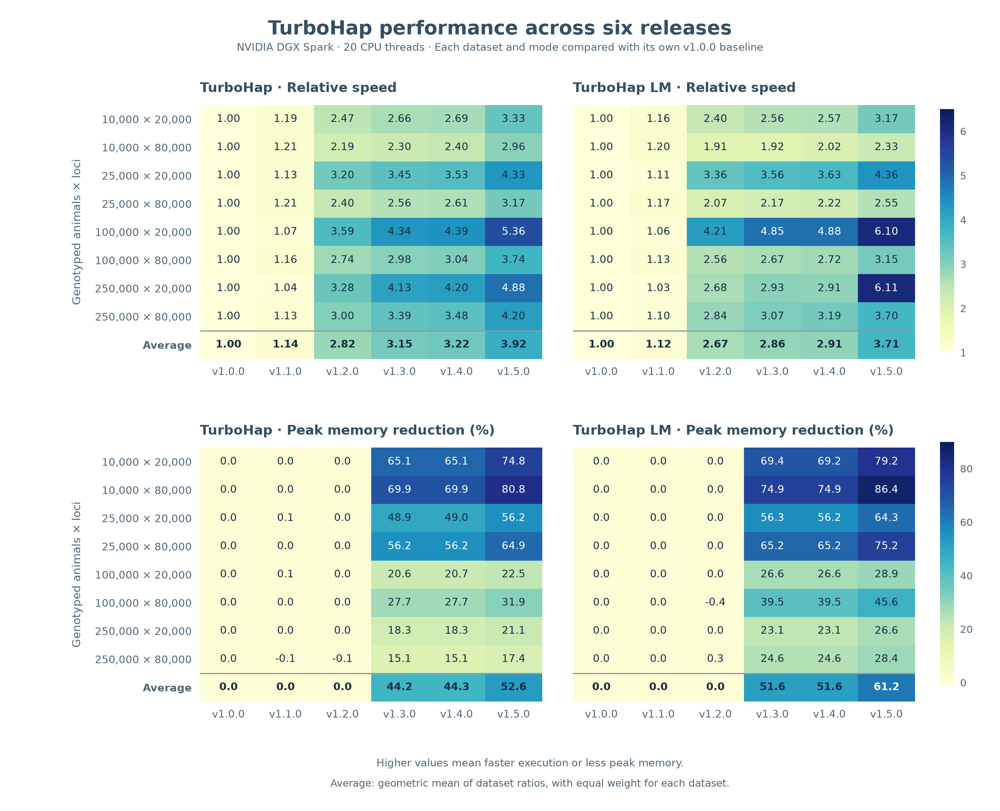

# TurboHap performance across releases

Across eight matched datasets, v1.5.0 ranked first for runtime and peak memory in both modes.

Each row shows one dataset. **Relative speed is v1.0.0 runtime divided by the newer runtime** (2 means twice as fast). **Peak memory reduction** is the percentage reduction from v1.0.0. Higher values are better in all four panels; the colour scale is shared between modes for each metric. The average row gives each dataset equal weight: it uses the geometric mean of the speed ratios, and converts the geometric mean of the memory-use ratios into a percentage reduction.

**Improvements in v1.5.0**

| Compared with | Mode | Fold speedup | Less peak memory |
| --- | --- | --- | --- |
| v1.4.0 | TurboHap | 1.22× | 15% |
| v1.4.0 | TurboHap LM | 1.27× | 20% |
| v1.0.0 | TurboHap | 3.92× | 53% |
| v1.0.0 | TurboHap LM | 3.71× | 61% |

**How we compared the releases.** We ran both modes on the same eight simulated dairy cattle datasets (10,000 to 250,000 genotyped animals, each at 20,000 and 80,000 loci). We used one measurement per version, dataset and mode, with matching analysis settings and 20 CPU threads on an NVIDIA DGX Spark. We built each release with GCC 13.3 using its release defaults. Comparisons always use the same dataset and mode in the reference release.

The exact inputs for all nine benchmarks are available on Zenodo. [Dataset DOI 10.5281/zenodo.24144449](https://doi.org/10.5281/zenodo.24144449)

**Output checks.** Of 960 output-file checks, 958 matched byte for byte. In the two v1.0.0 runs on the 25,000-animal, 80,000-locus dataset, two values in `hap.filled` differed by 0.0001 in each run. All other checked bytes matched.

[Underlying measurements (JSON, `matched_release_comparison`)](turbohap_benchmarks_111126.json) · [v1.5.0 versus GNU FindHap](turbohap_benchmarks_111126.md)
