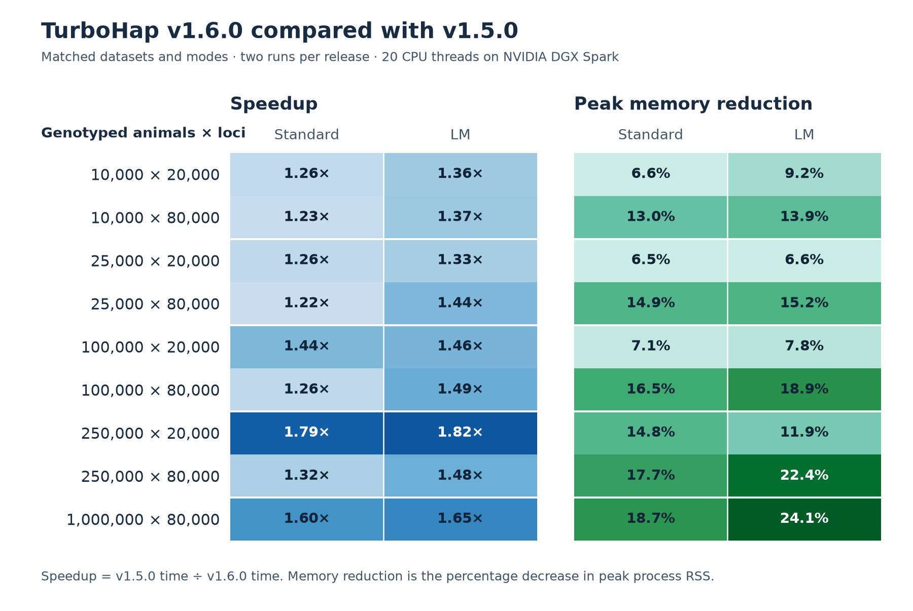

# Performance compared with TurboHap v1.5.0

Across nine datasets, the speedup was **1.36× in Standard** and **1.48× in LM**. Peak memory fell **13.0%** and **14.7%**, respectively. Of the 18 dataset–mode comparisons, 18 finished sooner and 18 used less peak memory.

Each row compares the arithmetic mean of two technical runs per release on the same inputs, in the same mode and at 20 threads. A speedup of 1.50× means that v1.5.0 took 1.50 times as long. The overall figures give each of the nine datasets equal weight by taking the geometric mean of the nine time ratios and the nine memory ratios separately.

| Genotyped animals × loci | Mode | v1.5.0 time (s) | v1.6.0 time (s) | Speedup | v1.5.0 peak (GiB) | v1.6.0 peak (GiB) | Peak memory reduction |
| --- | --- | --- | --- | --- | --- | --- | --- |
| 10,000 × 20,000 | Standard | 3.17 | 2.52 | 1.26× | 0.364 | 0.340 | 6.6% |
| 10,000 × 20,000 | LM | 4.07 | 3.00 | 1.36× | 0.289 | 0.263 | 9.2% |
| 10,000 × 80,000 | Standard | 9.08 | 7.39 | 1.23× | 1.006 | 0.875 | 13.0% |
| 10,000 × 80,000 | LM | 14.71 | 10.75 | 1.37× | 0.670 | 0.577 | 13.9% |
| 25,000 × 20,000 | Standard | 8.64 | 6.84 | 1.26× | 0.774 | 0.724 | 6.5% |
| 25,000 × 20,000 | LM | 10.35 | 7.77 | 1.33× | 0.568 | 0.530 | 6.6% |
| 25,000 × 80,000 | Standard | 23.16 | 19.06 | 1.22× | 2.206 | 1.877 | 14.9% |
| 25,000 × 80,000 | LM | 36.28 | 25.24 | 1.44× | 1.360 | 1.153 | 15.2% |
| 100,000 × 20,000 | Standard | 55.63 | 38.59 | 1.44× | 2.740 | 2.546 | 7.1% |
| 100,000 × 20,000 | LM | 61.67 | 42.38 | 1.46× | 1.944 | 1.791 | 7.8% |
| 100,000 × 80,000 | Standard | 105.05 | 83.08 | 1.26× | 7.720 | 6.444 | 16.5% |
| 100,000 × 80,000 | LM | 157.98 | 106.17 | 1.49× | 4.326 | 3.510 | 18.9% |
| 250,000 × 20,000 | Standard | 245.84 | 137.15 | 1.79× | 7.288 | 6.206 | 14.8% |
| 250,000 × 20,000 | LM | 265.23 | 145.48 | 1.82× | 5.249 | 4.627 | 11.9% |
| 250,000 × 80,000 | Standard | 299.39 | 226.39 | 1.32× | 18.081 | 14.887 | 17.7% |
| 250,000 × 80,000 | LM | 432.10 | 291.33 | 1.48× | 9.646 | 7.482 | 22.4% |
| 1,000,000 × 80,000 | Standard | 1,966.59 | 1,228.24 | 1.60× | 85.328 | 69.382 | 18.7% |
| 1,000,000 × 80,000 | LM | 2,546.22 | 1,543.21 | 1.65× | 51.259 | 38.885 | 24.1% |

Both releases used GCC 13.3.0 on the same DGX Spark. The published v1.5.0 measurements ran in a container and the v1.6.0 measurements ran on the host. The two million-animal Standard measurements coincided with system-wide swap activity. The host counters cannot attribute it to a particular process. These are end-to-end differences observed in separate benchmark sessions.

[Individual current measurements](turbohap_benchmarks_201126.csv) · [Previous measurements and machine-readable comparison inputs](turbohap_benchmarks_201126.json) · [Published v1.5.0 evidence](https://github.com/adrian-greenneuron/TurboHap/blob/v1.5.0/docs/turbohap_benchmarks_111126.md) · [Performance across seven releases, v1.0.0 to v1.6.0](turbohap_release_history_201126.md)
