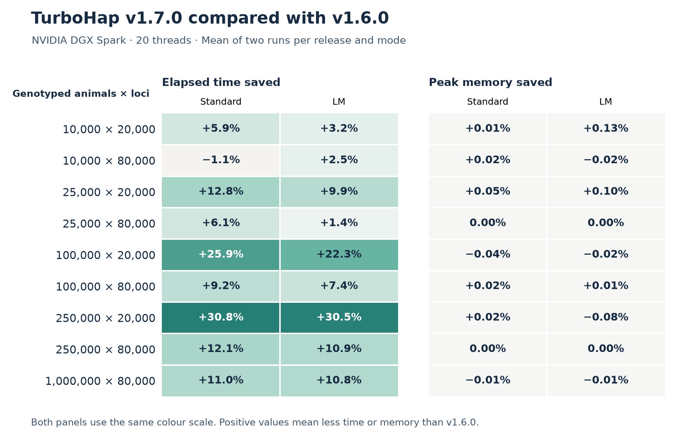

# TurboHap v1.7.0 compared with v1.6.0

Across the nine Spark benchmarks, v1.7.0 used **13.1% less time in Standard** and **11.5% less in LM** than v1.6.0, giving each dataset equal weight. The largest change in mean peak memory was 0.13%.

17 of the 18 dataset–mode combinations finished sooner. The exception was 10,000 × 80,000 in Standard, which took 7.47 s versus 7.39 s (1.1% longer).

Each row compares the mean of two runs per release, using the same mode, input files, settings and 20 CPU threads on the same DGX Spark. The figure and table use the same sign convention. Positive percentages mean less time or memory than v1.6.0. A negative value means v1.7.0 used more.

| Genotyped animals × loci | Mode | v1.6.0 time (s) | v1.7.0 time (s) | Time saved | v1.6.0 peak (GiB) | v1.7.0 peak (GiB) | Memory saved |
| --- | --- | --- | --- | --- | --- | --- | --- |
| 10,000 × 20,000 | Standard | 2.52 | 2.38 | +5.9% | 0.340 | 0.340 | +0.01% |
| 10,000 × 20,000 | LM | 3.00 | 2.90 | +3.2% | 0.263 | 0.262 | +0.13% |
| 10,000 × 80,000 | Standard | 7.39 | 7.47 | −1.1% | 0.875 | 0.875 | +0.02% |
| 10,000 × 80,000 | LM | 10.75 | 10.48 | +2.5% | 0.577 | 0.577 | −0.02% |
| 25,000 × 20,000 | Standard | 6.84 | 5.96 | +12.8% | 0.724 | 0.724 | +0.05% |
| 25,000 × 20,000 | LM | 7.77 | 7.00 | +9.9% | 0.530 | 0.530 | +0.10% |
| 25,000 × 80,000 | Standard | 19.06 | 17.89 | +6.1% | 1.877 | 1.877 | 0.00% |
| 25,000 × 80,000 | LM | 25.24 | 24.89 | +1.4% | 1.153 | 1.153 | 0.00% |
| 100,000 × 20,000 | Standard | 38.59 | 28.61 | +25.9% | 2.546 | 2.547 | −0.04% |
| 100,000 × 20,000 | LM | 42.38 | 32.92 | +22.3% | 1.791 | 1.792 | −0.02% |
| 100,000 × 80,000 | Standard | 83.08 | 75.41 | +9.2% | 6.444 | 6.443 | +0.02% |
| 100,000 × 80,000 | LM | 106.17 | 98.34 | +7.4% | 3.510 | 3.509 | +0.01% |
| 250,000 × 20,000 | Standard | 137.15 | 94.90 | +30.8% | 6.206 | 6.205 | +0.02% |
| 250,000 × 20,000 | LM | 145.48 | 101.07 | +30.5% | 4.627 | 4.631 | −0.08% |
| 250,000 × 80,000 | Standard | 226.39 | 199.05 | +12.1% | 14.887 | 14.887 | 0.00% |
| 250,000 × 80,000 | LM | 291.33 | 259.71 | +10.9% | 7.482 | 7.482 | 0.00% |
| 1,000,000 × 80,000 | Standard | 1,228.24 | 1,092.97 | +11.0% | 69.382 | 69.386 | −0.01% |
| 1,000,000 × 80,000 | LM | 1,543.21 | 1,376.93 | +10.8% | 38.885 | 38.889 | −0.01% |

The across-dataset summary takes the geometric mean of the nine v1.7.0/v1.6.0 ratios before converting to a percentage. Both releases used GCC 13.3.0. Measurements were made in separate sessions.

The published v1.6.0 million-animal Standard runs coincided with host swap activity. For v1.7.0 the benchmark requested eviction of the genotype file from cache before each million-animal Standard run to reduce memory pressure. The other v1.7.0 runs used warmed inputs. The timing differences on that row reflect both the software and the conditions in which the measurements were made.

[Individual measurements (CSV)](turbohap_benchmarks_221126.csv) · [Settings, previous measurements and file checks (JSON)](turbohap_benchmarks_221126.json) · [Published v1.6.0 results](https://github.com/adrian-greenneuron/TurboHap/blob/v1.6.0/docs/turbohap_benchmarks_201126.md) · [Performance across eight releases](turbohap_release_history_221126.md)
