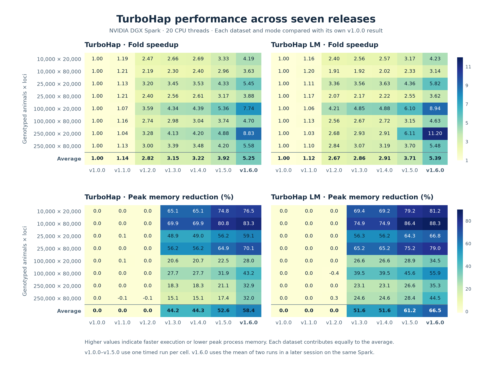

# TurboHap performance across seven releases

Across eight matched cattle datasets, v1.6.0 delivered a **5.25× speedup with 58.4% lower peak memory in Standard** and a **5.39× speedup with 66.5% lower peak memory in LM** compared with v1.0.0.

Read each row from left to right to follow one dataset through the releases. Each mode uses its own v1.0.0 baseline. A speedup of 2× means the run took half as long. A 50% reduction means it used half as much peak resident memory.

## Improvements in v1.6.0

| Compared with | Mode | Fold speedup | Peak memory reduction |
| --- | --- | --- | --- |
| v1.5.0 | Standard | 1.34× | 12.3% |
| v1.5.0 | LM | 1.45× | 13.5% |
| v1.0.0 | Standard | 5.25× | 58.4% |
| v1.0.0 | LM | 5.39× | 66.5% |

Each of the eight datasets contributes equally to the summary. We use the geometric mean of the eight speed ratios. For memory, we take the geometric mean of the eight ratios of new to old peak memory and express the saving as a percentage.

## Which runs are included?

The eight workloads cover 10,000, 25,000, 100,000 and 250,000 genotyped animals, each at 20,000 and 80,000 loci. All seven releases used matching inputs and analysis settings, 20 CPU threads and GCC 13.3 on the same NVIDIA DGX Spark. For v1.0.0 through v1.5.0 we used the single measurement per dataset and mode from the published six-release study. For v1.6.0 we used the arithmetic mean of its two technical repeats. The runs took place in separate sessions, so small differences can reflect run-to-run variation.

The [nine-dataset comparison with v1.5.0](turbohap_release_comparison_201126.md) includes the million-animal workload and uses two runs per release from the dedicated release benchmarks. That gives it a different v1.5.0 baseline from the historical series shown here.

**Output checks.** The historical study recorded 958 byte-for-byte matches in 960 comparisons. In each mode of v1.0.0 on 25,000 animals × 80,000 loci, two values in `hap.filled` differed by 0.0001. All 320 output checks from the v1.6.0 runs on these eight workloads matched their references byte for byte.

[Historical measurements (CSV)](turbohap_historical_benchmarks_111126.csv) · [v1.6.0 runs (CSV)](turbohap_benchmarks_201126.csv) · [Original six-release study](https://github.com/adrian-greenneuron/TurboHap/blob/v1.5.0/docs/turbohap_release_comparison_111126.md) · [Benchmark datasets on Zenodo](https://doi.org/10.5281/zenodo.24144449)
