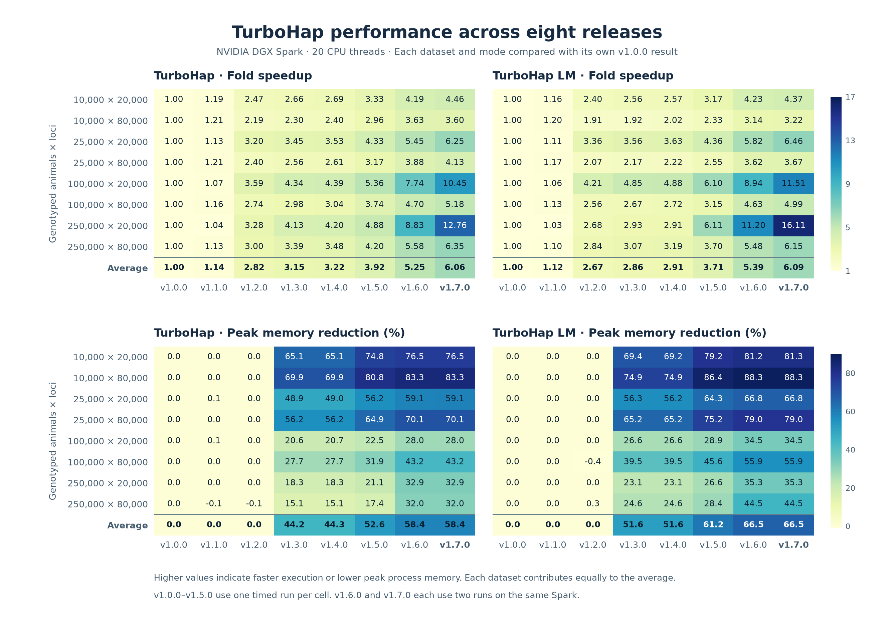

# TurboHap performance from v1.0.0 to v1.7.0

Across eight matched datasets, Standard was **6.06× as fast** as v1.0.0 with **58.4% lower peak memory**. LM was **6.09× as fast** with **66.5% lower peak memory**.

Each row follows one dataset. Each mode uses its own v1.0.0 result as the baseline. A speedup of 2× means the analysis finished in half the time.

## Changes in v1.7.0

| Compared with | Mode | Speedup | Peak memory saved |
| --- | --- | --- | --- |
| v1.6.0 | Standard | 1.15× | 0.0% |
| v1.6.0 | LM | 1.13× | 0.0% |
| v1.0.0 | Standard | 6.06× | +58.4% |
| v1.0.0 | LM | 6.09× | +66.5% |

Each of the eight datasets contributes equally. The summary uses geometric means of ratios between releases. The two most recent releases use the mean of two technical repeats per mode. For v1.0.0 through v1.5.0 the published historical study timed each mode once on each of the eight datasets. All used 20 threads and GCC 13.3 on the DGX Spark.

These eight workloads include 10,000 to 250,000 animals at 20,000 and 80,000 loci. The separate nine-dataset release comparison also includes one million animals.

The original six-release study recorded 958 byte-for-byte matches in 960 comparisons. On 25,000 × 80,000, two values in the v1.0.0 `hap.filled` file differed by 0.0001 in both modes. All 320 v1.7.0 files on the eight common workloads matched their references.

[Historical measurements (CSV)](turbohap_historical_benchmarks_111126.csv) · [Individual measurements (CSV)](turbohap_benchmarks_221126.csv) · [Settings, previous measurements and file checks (JSON)](turbohap_benchmarks_221126.json) · [Comparison with v1.6.0](turbohap_release_comparison_221126.md) · [Original six-release study](https://github.com/adrian-greenneuron/TurboHap/blob/v1.5.0/docs/turbohap_release_comparison_111126.md)
